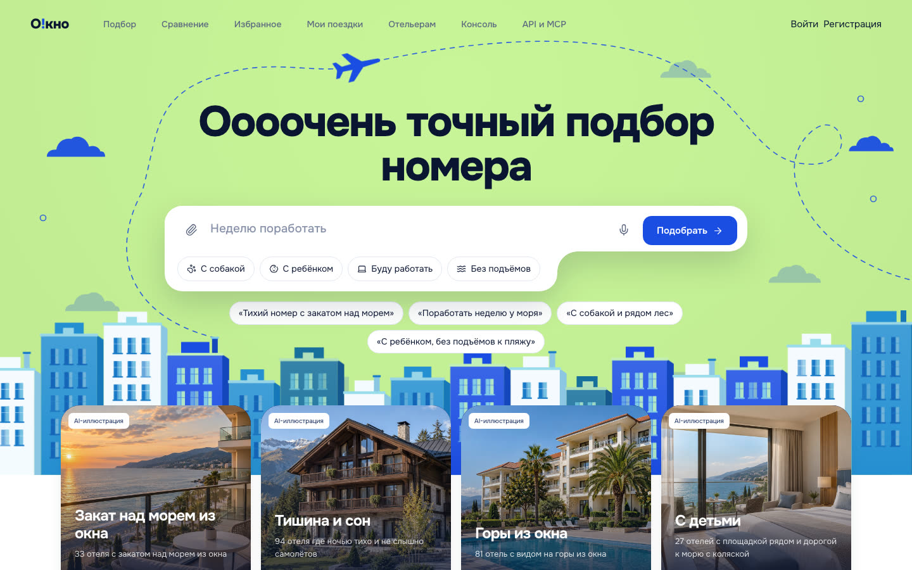
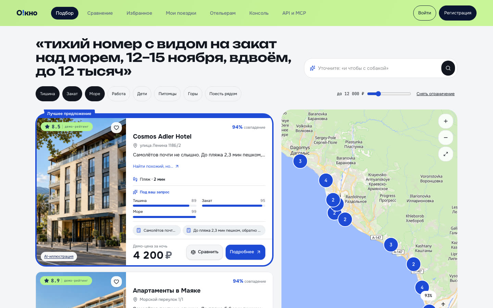
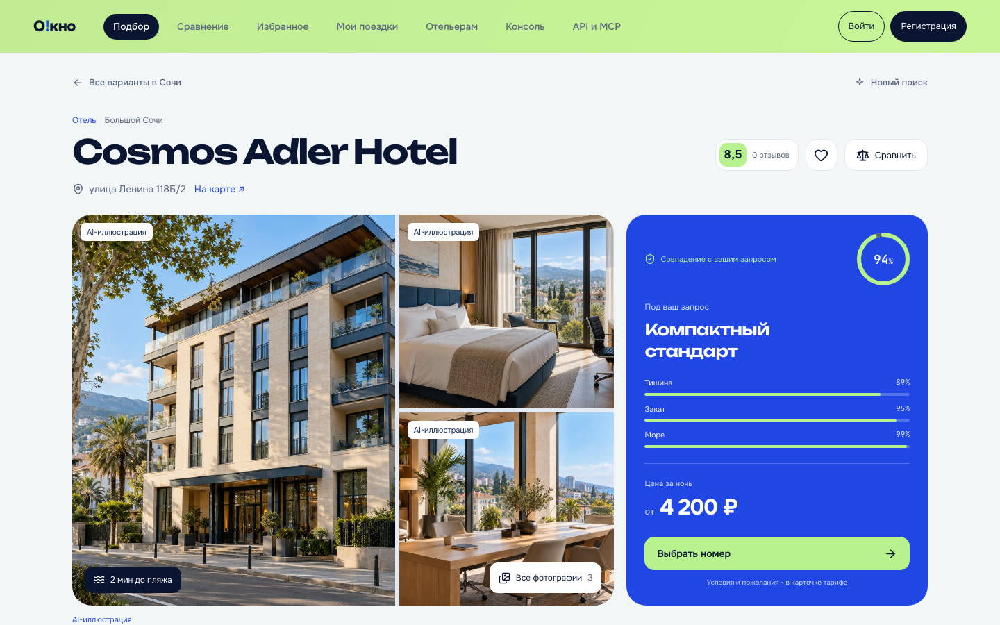
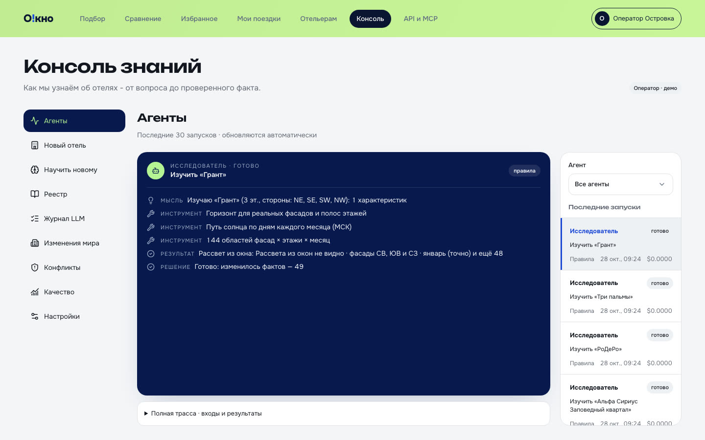
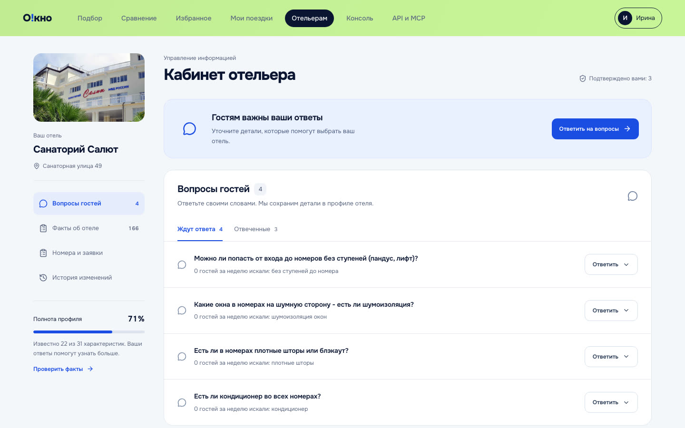

# О!кно

Островок знает о номере больше, чем его карточка, и может это доказать.

Команда chupapis, трек «О!дин шаг до идеального отеля», Ostrovok Hackathon 2026.

О!кно собирает знания об отелях Большого Сочи, которых нет в карточках. Видно ли море из окна на этой
стороне и этаже. Садится ли солнце в море в ноябре. Тихо ли ночью. Сколько идти до пляжа и сколько
подниматься обратно. Работает ли рядом ночная аптека. Каждый факт хранится вместе с тем, к каким фасадам,
этажам и месяцам он относится, откуда он взялся, насколько мы в нём уверены и чем это подтверждается.
Гость описывает поездку своими словами и получает не просто «отель с видом», а конкретный номер, который
стоит попросить при бронировании.

- 200 реальных отелей из OpenStreetMap: центр Сочи, Хоста, Адлер, Сириус, Красная Поляна.
- Знания считаются из открытых данных. Здания, дороги, железная дорога и берег берутся из OSM, рельеф из
  Copernicus DEM, климат из Open-Meteo. Вид из окна считается по линии горизонта, закат по траектории
  солнца, шум по источникам вокруг, путь до пляжа по пешеходному графу с учётом уклона.
- Знания добывают агенты, и их работу видно в интерфейсе. Исследователь считает факты. Куратор учит
  систему новой характеристике по описанию. Связной задаёт вопросы отельеру и разбирает ответы. Сверщик
  сводит источники и решает конфликты. Наблюдатель пересчитывает факты, когда меняется окружение.
- Всё работает без ключа LLM. С ключом система лучше понимает свободный текст, без ключа ту же работу
  делают правила, и в ходе агента видно, что сработало.

Демо-видео: [смотреть на Google Drive](https://drive.google.com/file/d/1CpJqB94Zq_3jM0eTI2mJ-tYtdcpiQAoN/view?usp=sharing).

Презентация: [смотреть на Google Drive](https://drive.google.com/file/d/1t61Ov_OwW4gzXfKq4MS8SH0gsQk3hDd8/view?usp=sharing), PDF также лежит в репозитории: [assets/presentation/okno.pdf](assets/presentation/okno.pdf).

Попробовать без установки: [ostrovok-okno.vercel.app](https://ostrovok-okno.vercel.app).



| Выдача: какой номер просить и почему | Страница отеля: окно, ночь, маршрут |
|---|---|
|  |  |
| **Консоль знаний: агенты за работой** | **Кабинет отельера: только то, что нельзя посчитать** |
|  |  |

## Запуск

Нужен только Docker с Compose v2.

```sh
git clone https://github.com/ostrovok-hackathon-2026/chupapis.git
cd chupapis
cp .env.example .env
docker compose up --build
```

Приложение откроется на [localhost:8080](http://localhost:8080). Первая сборка занимает от двух до шести минут, на чистой
четырёхъядерной x86-машине без кэша около 100 секунд. Миграции, ключи и демо-данные сервис init загружает
сам, руками ничего делать не нужно.

| Адрес | Что там |
|---|---|
| http://localhost:8080/ | приложение: гость, кабинет отельера, консоль знаний |
| http://localhost:8080/health | проверка работоспособности, ответ {"status":"ok"} |
| http://localhost:8080/api/docs | описание REST API (Swagger) |
| http://localhost:8080/mcp | MCP-сервер со знаниями об отелях для внешних ИИ-ассистентов |

Остановить: docker compose down. Начать с чистой базы: docker compose down -v.

Образы собираются под linux/amd64. На Mac с Apple Silicon они работают через эмуляцию и отвечают заметно
медленнее. Быстрее будет, если в Docker Desktop включить Use Rosetta for x86_64/amd64 emulation
(Settings → General). Если Rosetta недоступна, запускайте нативные образы:

```sh
docker compose -f docker-compose.yml -f compose.dev.yml up --build
```

Ресурсы: 2 ядра CPU и больше, около 4 ГБ свободной памяти и 5 ГБ диска под образы. Всё, что нужно,
поднимает Compose: PostgreSQL 17 с PostGIS (db), Redis (redis), API и воркер агентов (backend, worker),
интерфейс (frontend) и шлюз nginx на порту 8080 (gateway). Логи всех сервисов пишутся в stdout,
смотреть их можно командой docker compose logs.

### С ключом LLM

Для проверки подготовлен отдельный ключ Polza.ai с моделью openai/gpt-5.6-luna и лимитом 100 рублей.
Он лежит в [secrets.env.age](secrets.env.age), зашифрованный публичным ключом организаторов. Расшифровать и запустить
из корня репозитория:

```sh
age -d -i /path/to/organizer-key.txt -o .env.decrypted secrets.env.age &&
mv .env.decrypted .env &&
docker compose up --build
```

Подойдёт и любой другой OpenAI-совместимый провайдер. Нужные строки в .env:

```sh
LLM_BASE_URL=https://polza.ai/api/v1
LLM_API_KEY=...
LLM_MODEL=openai/gpt-5.6-luna
```

Для прямого OpenAI адрес https://api.openai.com/v1, а модель указывается без префикса openai/.

Модель выбрана по прогону на наших размеченных наборах (make eval-llm). На отложенной выборке разбор
пожеланий гостя дал F1 0,96, разбор ответов отельеров 0,96, выбор метода Куратором 0,93, медиана разбора
запроса около 3 секунд. Подробности в [backend/data/eval/README.md](backend/data/eval/README.md). Каждый вызов модели с запросом,
ответом, токенами, ценой и временем виден в консоли оператора. Если провайдер недоступен, вернул ошибку
или упёрся в лимит, агенты продолжают работать по правилам. LLM можно выключить и вручную в консоли.

Без внешнего API можно запустить локальную модель:

```sh
docker compose --profile local-llm up --build
docker compose exec ollama ollama pull qwen2.5:3b
```

и указать в .env LLM_BASE_URL=http://ollama:11434/v1, LLM_API_KEY=ollama, LLM_MODEL=qwen2.5:3b.

## Как войти

Поиск и страницы отелей открыты всем. Для брони, поездок, кабинета отельера и консоли нажмите «Войти»
или откройте нужный раздел: там есть тестовые аккаунты, вход в один клик без пароля. Можно и
зарегистрироваться по почте.

| Аккаунт | Роль | Что доступно |
|---|---|---|
| Анна | гость | поиск, бронь, поездки, профиль вкуса с демо-историей |
| Марк | гость | то же без истории |
| Ирина, Олег, Светлана | отельеры | кабинет своего отеля: факты, вопросы, разметка фасадов, заявки гостей |
| Оператор Островка | консоль | агенты, реестр характеристик, журнал LLM, конфликты, изменения окружения, качество |

## Что попробовать

1. Найти номер словами: «тихий номер с видом на море и закатом, 12–15 ноября, вдвоём». Для каждого отеля
   выдача покажет, какой номер просить (например, юго-западная сторона, этаж от четвёртого), что из
   пожеланий сбывается и где компромисс.
2. Нажать «почему» у любого факта: метод, источники, доказательство (панорама окна, схема шума, профиль
   маршрута) и уверенность.
3. Добавить неизвестное пожелание, например «хинкальная в 10 минутах пешком». Куратор научит систему новой
   характеристике, Исследователь посчитает её для выдачи, и всё это видно по ходу работы.
4. Спросить отель: «можно ли с собакой 30 кг». Связной отправит вопрос, демо-отельер ответит через
   несколько секунд, ответ превратится в факт и изменит выдачу.
5. На странице отеля нажать «Найти похожий, но…» и выбрать: тише, ближе к морю или дешевле.
6. Забронировать номер с пожеланием к расположению. Заявка демонстрационная, оплата не списывается,
   отель отвечает в «Моих поездках».
7. Посмотреть конфликт. Отель пишет «вид на море из всех номеров», а расчёт видит море только с одной
   стороны. Правило «физика сильнее описания» показывает это и отельеру, и оператору.
8. В консоли «построить дом» рядом с отелем. Наблюдатель найдёт затронутые отели и пересчитает вид, закат
   и шум.
9. В консоли открыть «Новый отель» и запустить изучение реального отеля из OSM: агенты соберут о нём
   знания примерно за полминуты и зададут отельеру вопросы о том, что нельзя посчитать.
10. На главной продиктовать запрос голосом или приложить фото вида, который хочется. По фото модель
    сформулирует пожелание, которое можно поправить перед поиском. Для фото нужен ключ LLM, само фото
    нигде не сохраняется.

## Как устроено

Подробно в [backend/ARCHITECTURE.md](backend/ARCHITECTURE.md).

```text
gateway (nginx, :8080) ─┬─ /            → frontend (TanStack Start)
                        ├─ /api, /mcp   → backend (FastAPI)
                        └─ /health      → backend
backend, worker         один образ: API и воркер агентов с очередью задач в PostgreSQL
init                    миграции, ключи JWT, демо-данные при старте
db                      PostgreSQL 17 + PostGIS          redis   события и лимиты
```

LLM в системе только переводит и компилирует: разбирает текст гостя, ответы отельеров и описание новой
характеристики. Факты дают расчёты по открытым данным и отельеры, а объяснения модель может строить
только из переданных ей фактов.

Новая характеристика добавляется как запись в реестре с рецептом из готового набора методов: вид, событие
солнца, шум, путь пешком, объекты рядом, статистика района, климат, вопрос отельеру, производная от других.
Для этого не нужен код. Новый метод уже требует кода и тестов.

Наблюдения из разных источников сводятся с учётом надёжности источника. Уверенность со временем снижается,
конфликты разрешаются правилом характеристики, ответы отельеров уточняют расчёт. Бэкенд устроен как
модульный монолит со слоями api, service и domain. Границы слоёв проверяет import-linter, типы mypy в
строгом режиме, поведение юнит- и интеграционные тесты на настоящем PostGIS.

## API и MCP

Публичный MCP-сервер: [okno-api.fly.dev/mcp](https://okno-api.fly.dev/mcp), без авторизации. Локально после запуска он доступен
на http://localhost:8080/mcp, но облачным ассистентам нужен публичный адрес. Описание REST API:
[okno-api.fly.dev/api/docs](https://okno-api.fly.dev/api/docs), примеры запросов на странице «API и MCP» в приложении.

Подключить к Claude: Customize → Connectors → Add custom connector, имя «О!кно», адрес сервера выше,
без входа. Потом включить его в чате через «+» → Connectors.
[Инструкция Claude](https://support.claude.com/en/articles/11175166-get-started-with-custom-connectors-using-remote-mcp).

Подключить к ChatGPT: Plugins → «+» → Add custom MCP server, имя «О!кно», адрес сервера выше, без
авторизации. Потом выбрать его в чате через @.
[Инструкция ChatGPT](https://developers.openai.com/api/docs/guides/custom-mcp-server).

Пример вопроса: «Через О!кно найди тихий номер с закатом над морем в Сочи на 12–15 ноября вдвоём. Покажи три
варианта, какой номер просить и доказательства».

Сервер даёт пять инструментов, все только читают данные: поиск отелей, знания об отеле, объяснение факта,
сравнение отелей и список характеристик. Регион ограничен Большим Сочи. Цены и номера демонстрационные,
наличие мест и бронь через MCP не подтверждаются.

## Данные

Демо-данные лежат в репозитории (backend/data, около 30 МБ) и загружаются автоматически. Как они получены,
описано в [backend/data/MANIFEST.md](backend/data/MANIFEST.md). Повторить сбор: make data, затем make collect и make export-seed.

| Данные | Источник | Лицензия |
|---|---|---|
| Отели, здания, дороги, железная дорога, объекты, берег | © OpenStreetMap contributors, выгрузка Geofabrik | ODbL 1.0 |
| Рельеф | Copernicus DEM GLO-30, © DLR e.V., Airbus | Copernicus DEM licence |
| Климат и температура моря | Open-Meteo.com | CC BY 4.0 |
| Номера, цены, рейтинги, ответы отельеров, история гостя | синтетические, в интерфейсе помечены «демо» | |

Фотографии отелей взяты из Wikimedia Commons, с авторами и лицензиями. Где снимков нет или их мало,
галереи дополнены ИИ-иллюстрациями, и на каждой из них это написано. Такие иллюстрации не показывают
настоящий интерьер или вид из номера. Как подбирались фото, описано в [tools/hotel-photos/README.md](tools/hotel-photos/README.md).
Чужих отзывов и данных Островка в проекте нет.

## Настройки

Все переменные с безопасными значениями по умолчанию перечислены в [.env.example](.env.example).

| Переменная | По умолчанию | Зачем |
|---|---|---|
| LLM_BASE_URL, LLM_API_KEY | пусто | OpenAI-совместимый провайдер, без ключа работают правила |
| LLM_MODEL | gpt-5.6-luna | модель для обычных задач |
| LLM_MODEL_STRONG | пусто | модель для Куратора, по умолчанию та же |
| LLM_THINKING, LLM_THINKING_STRONG | low, medium | глубина рассуждений модели |
| LLM_TIMEOUT_SEC | 15 | тайм-аут вызова |
| LLM_MODE | auto | off оставляет только правила |
| LLM_DAILY_CALL_LIMIT | 300 | суточный лимит платных вызовов |
| HOTELIER_SIMULATOR, SIMULATOR_DELAY_SEC | on, 5-30 | демо-отельер и задержка его ответов |
| POSTGRES_USER, POSTGRES_PASSWORD, POSTGRES_DB | okno | база данных |
| APP_STAGE, LOG_LEVEL, LOG_JSON | dev, INFO, false | режим и логи в stdout |

## Разработка

Бэкенд: [backend/README.md](backend/README.md). Основные команды: make dev, make test, make check (ruff, mypy, import-linter,
тесты), make openapi.

Фронтенд: [frontend/README.md](frontend/README.md), архитектура в [frontend/ARCHITECTURE.md](frontend/ARCHITECTURE.md). React, TypeScript, TanStack Start, Tailwind CSS, Zustand, MapLibre,
структура Feature-Sliced Design. Нужны Node.js 22.12+ и npm:

```sh
cd frontend
npm ci
npm run dev
npm run check
```

На Apple Silicon весь стек можно поднять нативно командой make up-native.
