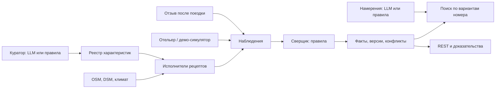

# Архитектура бэкенда «О!кно»

Документ описывает реализацию в `app/`. Команды запуска и расширения — в [README.md](README.md),
происхождение данных — в [data/MANIFEST.md](data/MANIFEST.md).

## 1. Слой знаний и роль LLM

Бэкенд хранит знания об отелях Большого Сочи: что видно из окна, насколько шумно у фасада,
как идти до пляжа, какие правила сообщил отель. Клиенты читают не только значение, но и его
область действия, источник, дату, уверенность, доказательства и историю изменений.

Основа — реестр характеристик, исполнители типизированных рецептов и хранилище знаний.
LLM используется как переводчик: запрос гостя → намерения, свободный ответ отельера → поля
схемы; и как компилятор: описание новой характеристики → рецепт. Значения получают расчёты
и ответы отельера; LLM не определяет, видно ли море из конкретного отеля. Объяснения выдачи
собираются шаблонами из фактов; LLM может перефразировать компромиссы трёх верхних результатов.
Код проверяет длину и отсутствие новых чисел, но не доказывает смысловую верность перефразирования.
У каждой роли с LLM есть двойник на правилах: без ключа и при сбое провайдера работает он.

## 2. Контуры исполнения

| Контур | Реализация |
|---|---|
| Предзаполнение | `pipeline/` готовит файлы региона; CLI `collect` считает характеристики в БД; отдельный `export-seed` выгружает знания и трассы в JSONL.gz |
| Живое исследование | Новое пожелание в поиске создаёт запуск и задачу; воркер исследует до восьми верхних кандидатов, при необходимости вызывает Куратора |
| Актуализация | Оператор добавляет или отменяет здание; Наблюдатель выбирает зависимые характеристики ближайших отелей и пересчитывает их |
| Чтение | Карточки и поиск читают сохранённые факты; повторное чтение поиска ранжирует его заново. Окно, маршрут и план дня могут выполнять георасчёты по запросу |

Вызов поиска не запускает полный сбор знаний. Без сида знаний нужно отдельно выполнить сбор.
Сидирование идемпотентно по хешам файлов и предыдущих этапов (`service/seed.py`): неизменившийся
этап пропускается, изменение входов может перезагрузить зависимые таблицы.

## 3. Агенты, планировщики и трассы

| Роль | Планировщик и действия |
|---|---|
| Исследователь | Правила: опубликованные рецепты → исполнители → наблюдения → `KnowledgeStore`. Производные характеристики считает последними; отсутствие данных оставляет неизвестным |
| Куратор | LLM с инструментами `osm_vocabulary` (словарь «слово → теги OSM») и `osm_tag_stats` (сколько таких объектов в регионе) или словарные правила. Ответ LLM типизирован объединением рецептов, неверный рецепт PydanticAI возвращает модели на исправление. Дальше пробный прогон максимум на пяти отелях и сохранение |
| Агент намерений | Структурированный ответ LLM или словарь синонимов, регулярные правила и нечёткое совпадение; результат — чипы пожеланий и параметры поездки |
| Связной | Выбирает вопросы по спросу за неделю, неопределённости и влиянию на выдачу (правила). Свободный ответ разбирает LLM в те же поля, что и правила, плюс признак «ответ однозначный»; формы и сбой LLM — правила. Уверенность ниже 0,6 — переспрос |
| Сверщик | Чистая доменная функция, вызываемая при записи наблюдений; отдельный LLM-запуск не нужен |
| Наблюдатель | Правила зависимости метода от изменения здания и расстояния; запускает Исследователя |
| Подборщик | Детерминированный скоринг и вердикты; шаблонные объяснения с необязательным LLM-перефразированием компромисса |
| Демо-отельер | Скрытые синтетические профили и шаблон ответа; с LLM пересказывает шаблон в стиле персоны («краткий», «многословный», «расплывчатый»), не меняя чисел. Отложенная задача, `is_demo=true` |

`service/agents/runtime.py` создаёт `agent_runs` и задачи в одной транзакции. `AgentRunner`
ведёт состояния `queued → running → done/failed`. `Tracer` сохраняет шаги `reason`, `tool`,
`decision`, `result`, `error`: краткое описание, аргументы, результат и длительность инструмента.
Это журнал решений и вызовов, а не внутренняя цепочка рассуждений модели. Вызов LLM внутри
запуска — отдельный шаг `llm.<задача>` с моделью, токенами, временем и ценой; инструменты,
которые вызвала модель, — обычные шаги `tool`. Расход суммируется в `agent_runs.usage`.

Шаг фиксируется короткой транзакцией, затем публикуется через Redis. SSE запуска воспроизводит
сохранённые шаги и передаёт новые; общий поток изменений доставляет текущие события без истории.
Redis служит транспортом уведомлений, долговременное состояние находится в PostgreSQL.

Очередь `jobs` использует `FOR UPDATE SKIP LOCKED`, аренду с продлением, `available_at`,
дедупликацию незавершённых задач, повтор с задержкой и состояние `dead`. После падения воркера
задачу с истёкшей арендой можно забрать повторно; обработчики должны учитывать повторное исполнение.
Статус агентного запуска и статус задания очереди хранятся отдельно.

`LanguageModel` реализован через PydanticAI и OpenAI-совместимый endpoint: к OpenAI — через
Responses API (рассуждения и инструменты вместе), к остальным (Gemini, OpenRouter, Yandex, Ollama) —
через Chat Completions. Моделей две: быстрая `LLM_MODEL` (намерения, ответы, формулировки) и
сильная `LLM_MODEL_STRONG` для Куратора, у каждой свой уровень рассуждений (`LLM_THINKING*`).
Кэш в БД учитывает endpoint, модель, уровень рассуждений, задачу, промпты, схему результата
и полные схемы инструментов. Сохранение alias-полей и чтение старых имён не теряют параметры поездки.
Есть тайм-аут, лимиты PydanticAI, суточный счётчик обращений и предохранитель на 60 секунд после
ошибок провайдера. Каждый вызов, включая попадания в кэш и сбои, пишется в журнал `llm_calls`:
запрос, ответ, вызовы инструментов, токены (с кэшированными), цена по genai-prices и задержка.
Консоль читает его через `/console/llm/calls` и `/console/llm/usage`. При недоступности LLM
используются правила; флаг в консоли выключает LLM без перезапуска.

## 4. Модель знаний

`Observation` хранит значение, `confidence`, `source`, `source_ref`, метод, область `Scope`,
время наблюдения и срок действия, доказательства, оговорки, версию характеристики и запуск.
Источники: `computed`, `open_data`, `hotelier`, `guest`, `demo_card`. Старые наблюдения сохраняются;
повторные утверждения источника могут помечаться вытесненными через `superseded_at`.

`Scope` задаёт фасады, нижний и верхний этаж, месяцы и категории номеров; `None` означает все
значения соответствующего измерения. Фасады — восемь румбов `N…NW`, этажи включительно,
месяцы `1…12`. Для пространственных вероятностных характеристик Сверщик раскладывает наблюдения
на сетку реальных фасадов × этажей × месяцев и сжимает совместимые ячейки обратно в области.
Категории номеров не являются четвёртой осью этой сетки: их связывает таблица `facade_rooms`.

`KnowledgeStore.record()` — путь записи новых знаний. Он блокирует пару «отель, характеристика»
через advisory lock, добавляет наблюдения, выполняет сверку и сохраняет текущие факты,
версии и конфликт в транзакции вызывающего `UnitOfWork`. Факт уникален по отелю, характеристике
и каноническому ключу области. У него есть статус `ok`, `stale` или `conflict`.

Версия создаётся при изменении значения, статуса или уверенности минимум на 0,05.
Пересчёт без существенного изменения не увеличивает номер. При изменении разбиения областей
старые строки текущих фактов могут удаляться; история хранится отдельно в `fact_versions`.
`GET /facts/{id}` возвращает факт, наблюдения и историю его характеристики.

Конфликт вероятностей — уверенное «да» (P ≥ 0,7) и «нет» (P ≤ 0,3) от разных типов источников
в одной ячейке. Для чисел используется относительное расхождение больше 50%; для записей
сравнивается основное поле, например `minutes` или `allowed`.
`authority` выбирает правило: расчёт и открытые данные (`physics`), отель (`hotelier`), самое
свежее наблюдение (`freshest`) или гости при достаточном числе наблюдений (`guests`).
Спор физического расчёта с отелем получает `waiting_hotel`; Связной умеет подготовить
точечный вопрос о категориях и этажах. Автоматического обучения надёжности каждого отеля нет.

## 5. Уверенность

Для булева факта `value` — утверждение, `confidence` — уверенность именно в этом значении.
Поэтому `value=false, confidence=0.95` означает P(да)=0,05. Поиск приводит факты к P(да).
Подписи уверенности: ≥0,85 «точно», ≥0,65 «скорее да», ≥0,35 «не уверены», ниже «скорее нет»;
это подпись сохранённого утверждения, а не натурная гарантия.

* Вид и солнце: доля успешных сценариев Монте-Карло. Меняются высоты соседних зданий
  (из `height` ±1,5 м, из этажности ±1 этаж, по умолчанию ±2 этажа), окно, этаж внутри полосы,
  смещение DSM ±2 м; для солнца ещё и дни месяца. Обычно 16 прогонов; 50 доступны через
  `env.extras["mc_runs"]`, CLI сбора сам этот режим не включает. Исследователь ограничивает
  уверенность наблюдения сверху значением 0,95.
* Шум: запас до границы класса и полнота источников, верхняя граница модели 0,75.
  Маршрут: неизвестные участки, подходы к графу и полнота данных снижают уверенность.
* Слияние: `logit(p) = logit(0.5) + Σ rₛ × (logit(pₛ) − logit(0.5))`.
  Веса `rₛ` заданы таблицей надёжности типов источников для выбранного `authority`.
* После 80% срока действия вероятность линейно приближается к 0,5, достигая её к истечению.
  Это применяется при сверке; чтение сохранённого факта само не запускает сверку.
* Булевы отзывы после поездки обновляют вероятность через бета-априор с весом 10:
  `p′ = (10p + yes) / (10 + yes + no)`, только в области обещания конкретной брони.

Монте-Карло описывает неопределённость принятой геометрической модели. Калибровка по фотоэталону
не выполнена; заявлять измеренную точность вида по этим вероятностям нельзя.

## 6. Расширяемость

Характеристика — запись реестра: ключ, синонимы, уровень, тип значения, рецепт, TTL, правило
источников, шаблоны утверждения и вопроса. Начальные определения загружаются из YAML;
далее реестр читается из БД. Состояния — `draft`, `provisional`, `published`.
Куратор из поиска сохраняет предварительную характеристику, из консоли — черновик.
Публикация оператором запускает расчёт по региону.

Закрытые схемы рецептов: `view`, `sun_event`, `noise`, `walk_to`, `poi_nearby`, `area_stat`,
`climate`, `ask_hotelier`, `derived`. Восемь вычислительных исполнителей регистрируются
в `bootstrap.default_executors()`, вопросы обслуживает контекст отельера.
Pydantic проверяет размеченное объединение рецептов и запрещает лишние поля.
Новая характеристика в рамках этих схем — данные; новый метод требует кода и тестов.

Имена вроде `geo.horizon` и `route.walk` в трассе обозначают этапы исполнителя.
Это не общий каталог инструментов, из которого LLM произвольно строит программу:
Куратору доступны только словарь мест и статистика тегов OSM, остальное делает код.

## 7. Гео и маршруты

Чистые ядра находятся в `domain/geo/`; файловые адаптеры — в `infra/geo/` за портами
`TerrainModel` и `Router`. Координаты хранения — WGS84, расстояния — метры в локальной
равнопромежуточной проекции. GDAL, rasterio и osmnx нужны только пайплайну.

| Расчёт | Реализация и границы |
|---|---|
| Фасады | Внешний контур, объединение почти коллинеарных рёбер, наружные нормали и румбы. Для вида выбирается длиннейшая стена румба и три положения окна; высота глаза `base + (floor − 0.5) × 3 м` |
| Горизонт | Shapely-пересечения лучей со зданиями до 2 км; DSM до 40 км; сектор ±70°, шаг 1°. Кривизна Земли и коэффициент рефракции 0,13 |
| Море и горы | Маска моря и угловые перекрытия; доля азимутов с видимым морем, минимальный этаж, видимые вершины OSM. Доля азимутов не равна площади моря на фотографии |
| Солнце | Astral, даты и время `Europe/Moscow`, путь солнца, геометрическая видимость события и время ухода диска за препятствие. Облачность не моделируется |
| Шум | Условные мощности дорог, ж/д, заведений, строек и авиации; энергетическая сумма, затухание по расстоянию, ориентация и экранирование зданиями. Индекс не является измеренным LAeq или санитарной оценкой |
| Пеший путь | Направленный граф OSM в NPZ, разреженные матрицы SciPy и Дейкстра. Скорость Тоблера `6 exp(−3.5 abs(s + 0.05))` км/ч; туда и обратно отдельные пути |
| Профили | `walk`, `stroller`, `wheelchair`: ступени запрещены для двух последних, крутые уклоны штрафуются. Счётчики ступеней и пересечений, подъём, профиль высот, доля неопределённого пути сохраняются |
| Климат и день | Многолетние нормы с указанным периодом; дневной план по POI, часам работы, маршрутам и проверке заката. Это не прогноз погоды |

Отсутствие DEM не превращается в нулевую высоту, отсутствие источников шума — в тишину.
При отсутствии роутера часть сценариев использует явно оценочный путь по прямой.
Известные ступени исключаются для коляски; неизвестные покрытия и реальные входы на пляжи
не позволяют считать рассчитанный маршрут подтверждением доступности.

Предрасчёт `window_profiles.zip` хранит номинальные профили фасадов и этажей, проверяет
подписи входных данных и здания; солнце рассчитывается на запрошенную дату.
Это ускорение панорамы, а не замена Монте-Карло. Кэши процесса и предрасчёт требуют
инвалидации после изменения мира (`WindowQueries.invalidate()`).

## 8. Поиск, номер и риск

Намерение содержит чипы с важностью `must/important/nice` (веса 3/2/1), параметры и даты.
Фильтруются район, вместимость и бюджет по начальной цене отеля. Варианты — категории
номеров с разметкой фасада и этажей; без разметки — сторона и полоса этажей для запроса отелю.
Это демо-тарифы, без проверки остатков реального поставщика.

Для варианта вычисляются P выполнения каждого пожелания по фактам подходящих ячеек и месяцев.
Для булевых фактов усредняются известные покрытые ячейки; если покрытия нет, ответ неизвестен.
В текущем скоринге непокрытые ячейки не штрафуются отдельно. Время до пляжа преобразуется
плавной функцией относительно желаемого порога; неизвестное получает приор 0,5.

`score = (Σ wᵢpᵢ / Σ wᵢ) × Πmust min(1, 0.5 + pᵢ)`.
`risk = 1 − Πimportant,must pᵢ` — эвристика риска, а не калиброванная вероятность разочарования.
Лучший вариант отеля выбирается по score, затем по меньшему риску. Вердикты — `yes` от 0,7,
`partial` от 0,4, иначе `no`; отсутствие знания — `unknown`. Выдача предлагает ослабления
и исследование неизвестных чипов. Источники и компромисс берутся из фактов.

Сравнение 2–3 отелей или вариантов использует тот же скоринг и проверяет выбранные
категории, фасады и этажи. «Как этот, но…» сохраняет часть положительных характеристик
исходного отеля и ищет подтверждённое улучшение цены, ночной тишины или времени до пляжа.

Бронь сохраняет снимок обещанных фактов с версиями и областью. После изменения фактов
отдельная задача проверяет будущие брони и создаёт уведомления. Отзыв доступен после выезда
по подтверждённой поездке и записывается как наблюдение `guest.feedback`.

## 9. Актуализация

`WorldEditor` добавляет синтетическое здание и запись `world_changes` вместе с задачей.
Наблюдатель очищает свой кэш сцен и пересчитывает `view/sun_event` в 2 км, `noise` в 500 м.
Откат здания запускает тот же путь. Сохраняются затронутые отели и запуск, публикуется событие.
Это управляемое изменение локального мира; автоматического получения изменений OSM нет.

TTL и затухание реализованы. Воркер раз в 10 минут ставит `freshness.scan`: до 30 фактов,
срок которых истекает в ближайшие 14 дней, по убыванию спроса ставятся на перепроверку тем же
Исследователем; то, что знает только отель, сверяется заново и показывается устаревшим до ответа.
Живое исследование `ask_hotelier` подключено через `HotelAsker`: создаёт вопросы верхним
кандидатам, дедуплицирует открытые и при включённом симуляторе ставит отложенные ответы.
Это отдельный путь от отбора общих вопросов по недельному спросу.

## 10. API и границы кода

REST — `/api/v1`, Swagger — `/api/docs`, схема — `/api/openapi.json`.
Есть отели, факты и доказательства, окно, шум, маршруты, климат, день, намерения и поиски,
сравнение и похожие варианты, брони и поездки, профиль вкуса, кабинет отельера и консоль.
`/runs/{id}/events` и `/events` внутри `/api/v1` — SSE.
`/health` проверяет жизнь процесса, `/api/ready` — доступность БД и Redis.
MCP SDK 2.x обслуживает `/mcp` через Streamable HTTP в stateless-режиме с JSON-ответами.
Пять инструментов: `search_hotels`, `get_hotel_knowledge`, `explain_fact`, `compare_hotels`,
`list_characteristics`. Они читают через те же сервисы, не создавая сохранённый поиск
и задачи исследования; разбор текста в MCP сейчас идёт по правилам.
Менеджер сессий запускается в lifespan FastAPI. Allowlist Host/Origin рассчитан на localhost;
для другого домена требуется изменить `TRANSPORT_SECURITY` в `api/mcp.py`.

Контрактные модели `ApiModel` сериализуются в camelCase; авторизация сохраняет отдельный
snake_case-контракт токенов. JWT RS256 и демо-персоны дают роли гостя, отельера и оператора;
кабинет проверяет принадлежность отеля через `hotel_staff`.

Слои: `api → service → domain`, адаптеры `db` и `infra`, общий `core`.
`service/` содержит сценарии, рецепты, агентов и порты; `db/` — ORM и репозитории;
`bootstrap.py` собирает зависимости. Сервисы и агенты могут обращаться к ORM через UoW:
абсолютной изоляции сервисов от SQLAlchemy здесь нет. Транзакцией владеет UoW, сервисы делают flush.

Семь контрактов import-linter запрещают обратные зависимости слоёв, фреймворки/ORM/адаптеры
в домене, HTTP в сервисах, вызовы сервисов из `db`, API из `infra`, зависимости `core`
от других модулей приложения и зависимости геоядер от поиска, агентов, отельера и брони.
Полного набора контрактов независимости всех бизнес-контекстов нет.

Применены порты и адаптеры, стратегия с fallback, реестр исполнителей, интерпретация рецептов,
UoW и репозитории, транзакционная очередь, разделение записи наблюдений и чтения фактов,
объект-значение `Scope`, функциональное геоядро. Это модульный монолит с отдельным процессом воркера.

## 11. База данных

| Контекст | Таблицы |
|---|---|
| Каталог | `hotels`, `buildings`, `osm_features`, `room_types`, `facade_rooms`, `world_changes` |
| Знания | `characteristics`, `observations`, `facts`, `fact_versions`, `conflicts` |
| Исполнение | `agent_runs`, `agent_steps`, `jobs`, `llm_cache`, `llm_calls`, `app_settings`, `seed_state` |
| Отельер | `hotel_staff`, `hotelier_questions`, `hotelier_answers`, `notifications`, `demand_daily` |
| Гость | `searches`, `bookings`, `trip_feedback`, `taste_profiles`, `user_events`, `quality_reports` |
| Авторизация | `users`, `auth_sessions` |

PostgreSQL 17 + PostGIS 3.5, SQLAlchemy async и asyncpg, миграции Alembic.
Геометрии имеют пространственные индексы, теги OSM — GIN.
Фасады вычисляются из контура, климат и граф читаются из файлов; отдельных таблиц
`facades`, `climate_normals` и `room_requests` нет. Реестр хранит текущую версию определения;
наблюдения помнят её номер, отдельного архива всех определений характеристики нет.

## 12. Docker, данные и проверка качества

Compose поднимает `db`, `redis`, одноразовый `init`, `backend`, `worker`, `frontend`, `gateway`.
Наружу опубликован порт 8080; nginx отправляет `/api/` в API, `/` во фронт, отключает
буферизацию SSE. `init` создаёт JWT-ключи в volume, применяет миграции и сид; API и воркер
ждут его завершения и здоровый Redis. Шлюз ждёт готовности API и фронта.
API и воркер используют один многостадийный образ Python 3.13, работают от пользователя `app`;
зависимости зафиксированы `uv.lock`. Основной Compose задаёт `linux/amd64`, отдельный
`compose.dev.yml` снимает это ограничение и открывает порты БД/Redis для локальной разработки.

В репозитории — 200 реальных OSM-объектов отелей пяти районов, геослои, DSM, граф, климат,
реестр и синтетические номера, тарифы, профили отельеров и история гостя.
Сырые PBF/GPKG/GeoTIFF остаются в локальном кэше; компактные файлы входят в образ.
Каталог загружается через COPY, знания — пакетным импортом JSONL.gz при наличии полного сида.
Точные состав, размеры, периоды и команды воспроизведения — в [MANIFEST](data/MANIFEST.md)
и [описании пайплайна](pipeline/README.md).

Атрибуция: © OpenStreetMap contributors, ODbL 1.0; Copernicus DEM — © DLR e.V. 2010–2014,
© Airbus Defence and Space GmbH 2014–2018, Copernicus DEM licence; Open-Meteo и поставщики
моделей — CC BY 4.0. Синтетические свойства помечены `isDemo`; это не заявления реальных отелей.

`make check` объединяет Ruff, форматирование, mypy strict, import-linter и pytest.
Unit-тесты покрывают геометрию, горизонты, солнце, шум, граф, области и сверку; интеграционные —
настоящие PostGIS и Redis, API, очередь, сид, ответы отеля и гостевые сценарии.
`make eval` оценивает намерения, машинные поля ответов отельеров, рецепты Куратора,
покрытие знаний, долю фактов с участием отеля и nDCG@10. Отчёт сохраняется в
`quality_reports`, последний доступен оператору через `/api/v1/console/quality`.
Для независимых булевых меток реализованы accuracy, ECE и бины надёжности, но
`data/eval/gold.yaml` пока пуст: точность вида и калибровка остаются неизмеренными.
Поисковый набор — фиксированная рубрика по вычисленным фактам, а nDCG показывает
согласованность выдачи с этой рубрикой внутри размеченного пула, а не независимую точность.
CLI `eval --llm` сравнивает LLM с правилами на намерениях, ответах отельеров и Куратора — на
наборах разработки и на независимом hold-out (`data/eval/holdout`, написан без просмотра правил),
меряет долю объяснений, прошедших проверку чисел, задержку и цену каждой задачи. Отчёты моделей
лежат в `data/eval/llm/`, сводная таблица — `make eval-compare`. Без флага внешние модели не вызываются.

### Проверка провайдеров (28.10)

Vertex AI поддержан через OpenAI-совместимый endpoint с `x-goog-api-key`;
Bearer-заголовок для такого ключа пуст. Пример команды и ограничения — в `data/eval/README.md`.
Метрики ответов и Куратора, как и намерений, исключают откат на правила; рядом выводится число
успешно оценённых ответов. Ошибка схемы отдельного ответа не отключает остальные задачи.
Цена — оценка успешных вызовов: таймауты могут стоить денег на стороне провайдера и не входят в неё.
