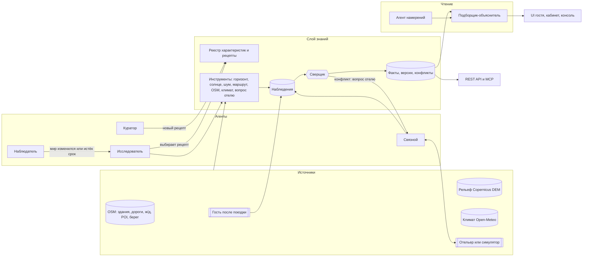
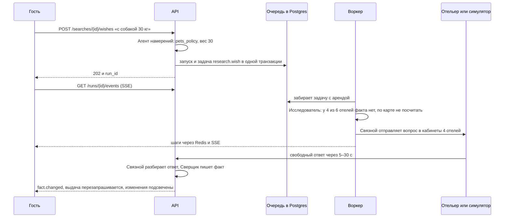
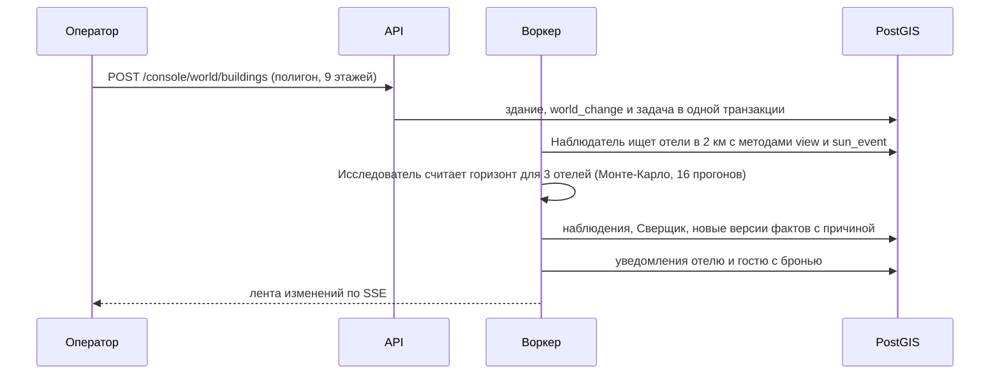

# 09. Бэкенд и агентная система

**Статус: согласовано владельцем 28.10.2026, около 01:00 МСК.** Решения, принятые после этого, и
отступления от документа записываем в [`docs/backend/decisions.md`](../backend/decisions.md); при
расхождении прав журнал. Задачи — в [`docs/backend/tasks.md`](../backend/tasks.md), журнал сессий — в
[`docs/backend/progress.md`](../backend/progress.md), порядок работы сессий — в
[`docs/backend/README.md`](../backend/README.md). Контракт перенесён в
[08 §9](08-design-brief.md#9-контракт-данных) (v2), порядок сборки — в [06](06-execution-plan.md).
§2–§14 почти без правок станут `backend/ARCHITECTURE.md` в репозитории сдачи; §1 и §15–§18 внутренние.

Опирается на кейс ([01](01-case-and-rules.md)), данные и алгоритмы ([04](04-data-and-tech.md)), концепцию
([05](05-concept-and-features.md)), текущий фронтенд (`frontend/`: Next.js, FSD, пока на моках) и шаблон
`~/Code/python/Monolith-backend-template`. Библиотеки сверены через Context7 28.10: PydanticAI 2.0,
MCP Python SDK 2.3, OpenAI-совместимый endpoint Gemini.

---

## 0. Решения на одной странице

| # | Вопрос | Решение | Почему |
|---|---|---|---|
| 1 | Форма системы | Модульный монолит: API и воркер из одного образа, PostgreSQL + PostGIS, Redis, фронт на Next.js, шлюз nginx на 8080 | Один регион, двое разработчиков, запуск у жюри с первого раза. Границы модулей держим линтером, а не сетью |
| 2 | Шаблон | Берём `Monolith-backend-template` и перестраиваем: оставляем слои, UoW, ошибки, логи, миграции, тесты, Docker и авторизацию; убираем S3 и аватары; outbox превращаем в очередь задач с арендой; добавляем PostGIS, контексты и рантайм агентов (§10.1) | Всё, что не отличает нас от других команд, уже написано и покрыто тестами |
| 3 | Роль LLM | Переводчик и компилятор: разбирает язык, собирает рецепт из наших инструментов, формулирует вопросы и объяснения. Записать факт LLM не может | Кейс прямо запрещает «спросить у LLM, есть ли вид». LLM вызывается на характеристику, а не на каждый отель |
| 4 | Агенты | Восемь ролей на общем рантайме: Исследователь, Куратор, Связной, Сверщик, Наблюдатель, Агент намерений, Подборщик-объяснитель и симулятор отельера. Планировщик у каждого двойной (LLM или правила), след шагов одинаковый | Агентность видна и без ключа; LLM делает систему гибче, но не держит её |
| 5 | Знания | Наблюдения (кто что утверждал) → Сверщик → факты (во что верим) + версии + конфликты. Область факта: фасад × этажи × месяцы × категории номеров | Источник, уверенность, дата и противоречия из требования 3 следуют из самой модели данных |
| 6 | Расширяемость | Характеристика — запись в реестре. Способ её получить — рецепт из закрытого набора методов над библиотекой инструментов. Новый метод — это код, новая характеристика — текст | Рецепт проверяется схемой, прогоняется на 5 отелях и показывается человеку |
| 7 | Уверенность | Монте-Карло по погрешностям расчёта, надёжность источника, слияние в лог-шансах, затухание к сроку годности, бета-обновление по отзывам, калибровка на эталоне | У числа уверенности есть смысл, и его можно проверить |
| 8 | Контуры | Пакетный (предзаполнение), событийный (актуализация), интерактивный (живое исследование) и чтение (поиск, API, MCP). Чтение не ждёт агентов | Быстрый поиск и обновления без гонок |
| 9 | Исполнение | Очередь задач в Postgres (`FOR UPDATE SKIP LOCKED` + аренда), отдельный воркер; шаги агентов пишутся в БД и уходят в браузер по SSE через Redis pub/sub | При падении ничего не теряется; без Celery и брокеров |
| 10 | LLM-провайдер | Любой OpenAI-совместимый endpoint через PydanticAI за нашими портами: OpenAI, Gemini, OpenRouter, DeepSeek, локальная модель. Без ключа и при сбое провайдера работают правила | Ключ у жюри не гарантирован, часть провайдеров недоступна из России |
| 11 | Гео | Тяжёлое (горизонт по рельефу с Монте-Карло, граф) считаем заранее. Лёгкое (окно номера, пересчёт после «построили дом», маршруты) считаем в рантайме теми же функциями | Данные воспроизводимы скриптами, доказательства пересчитываются по запросу |
| 12 | Маршруты | Свой пешеходный граф OSM с высотами из DEM в памяти: уклон по Тоблеру, ступени, переходы через ж/д, профиль «коляска». Без OSRM и Valhalla | Нужны свои веса; меньше данных в репозитории и быстрый старт |
| 13 | API | REST `/api/v1` с OpenAPI, SSE для хода агентов, MCP на `/mcp` поверх тех же сервисов | Один слой знаний для нашего UI, для Островка и для внешних агентов |
| 14 | Качество | Эталон, точность и калибровка, покрытие, доля вопросов отельеру, точность разбора ответов, nDCG поиска. `make eval` и страница качества | Доп. задача 5 и ответ на вопрос «как проверяли» |
| 15 | Контроль архитектуры | ruff, mypy strict, import-linter (слои и контексты), тесты на настоящем PostGIS, всё в `make check` | Поддерживаемость проверяет машина, как FSD-проверка на фронте |

---

## 1. Что ждут организаторы и где это у нас

| Требование | Где в бэкенде |
|---|---|
| **Ожидаемый результат** (обязателен): прототип для отелей одного региона, поиск по собранным характеристикам; запуск по README без многочасовой загрузки; ключ LLM описан в README и `.env.example` | ~200 отелей Большого Сочи; данные региона и собранные знания лежат в `backend/data/`, сид загружается автоматически; режим без ключа (§12, §13) |
| 1. Сбор характеристик: агент сам выбирает источники и инструменты; хотя бы одна характеристика вычисляется по геоданным | Реестр + методы + инструменты; Исследователь выбирает рецепт и запасной путь для отеля. Вид на море, закат, горы, шум, дорога до пляжа считаются по рельефу и OSM (§4, §5, §6) |
| 2. Диалог с отельером: вопрос при нехватке данных, свободный ответ раскладывается по полям; отельера можно имитировать | Связной: ценность вопроса, формулировка, разбор ответа по схеме характеристики. Симулятор отельера со скрытой правдой (§4.4) |
| 3. Хранение и достоверность: источник, уверенность, дата; противоречия замечаются и разбираются | Наблюдения → сверка → факты, версии, конфликты с правилом разрешения (§5) |
| 4. Расширяемость: новая характеристика текстом, без переписывания системы | Куратор: текст → рецепт → пробный прогон на 5 отелях → публикация; поиск сразу её понимает (§4.3, §5.2) |
| 5. Поиск по запросу своими словами | Агент намерений → чипы → вероятностное ранжирование по фактам с выбором номера (§7) |
| Доп. 1. Объяснение: «вид на закат есть, но только с 5-го этажа» | Вердикт по каждому чипу с областью действия и строка компромисса, собранные из фактов (§7) |
| Доп. 2. Сравнение отелей и номеров | `POST /compare` по чипам гостя (§7, §9) |
| Доп. 3. Кабинет отельера | Обзор фактов, подтвердить и исправить, вопросы, разметка фасадов, запросы гостей, спрос (§8) |
| Доп. 4. Актуализация: перепроверка устаревшего, реакция на изменения («построили дом») | Наблюдатель: изменение мира → зависимые факты → пересчёт → уведомления; плановые перепроверки по сроку годности (§3.3, §5.6) |
| Доп. 5. Метрики качества на своей разметке | Эталон, `make eval`, страница качества (§14) |
| Технические правила | Шлюз на 8080, `/health`, healthcheck, `depends_on`, multi-stage, non-root, `linux/amd64`, `.env.example`, миграции и сид на старте, логи в stdout (§12) |
| Приоритеты жюри: переиспользуемость → архитектура → обёртка | Слой знаний как отдельный блок с API и MCP; архитектура проверяется линтером и тестами (§2, §10) |

---

## 2. Главная идея

Для Островка мы строим **слой знаний об отелях**. Гостевой интерфейс, кабинет отельера, консоль и внешние
агенты — его клиенты. Слой состоит из трёх частей:

1. **Реестр характеристик.** Что система умеет знать и каким методом это получить. Это данные: новую
   характеристику добавляют без релиза.
2. **Инструменты.** Детерминированные функции, которые достают значение из открытых данных или у отельера:
   горизонт, солнце, шум, маршрут, поиск по OSM, климат, вопрос отелю. Это код с тестами.
3. **Хранилище знаний.** Кто что утверждал (наблюдения), во что мы верим (факты), где источники спорят
   (конфликты) и как менялось знание (версии).

Агенты соединяют эти части. Они выбирают метод и запасной путь для конкретного отеля, решают, когда
спрашивать отельера, разбирают споры источников и замечают, что мир изменился.

**Правило про LLM.** LLM переводит и компилирует:

- переводит текст гостя в чипы, свободный ответ отельера в поля, факты в понятное объяснение;
- компилирует описание новой характеристики в рецепт из наших инструментов. Это происходит один раз, дальше
  рецепт работает без LLM для всех отелей.

LLM не записывает факты. Её ответ проходит схему, потом его проверяют инструменты или человек. В объяснениях
LLM может ссылаться только на переданные ей факты и использовать только их числа; это проверяет код.
Поэтому стоимость LLM растёт с числом характеристик, запросов и ответов отельеров, а не с числом отелей.
Для 3 млн объектов Островка это решающая разница.



---

## 3. Четыре контура

### 3.1. Пакетный: предзаполнение

1. `pipeline/` скачивает и готовит сырые данные региона: OSM через Overpass, рельеф Copernicus, климат
   Open-Meteo, пешеходный граф. Результат лежит в `backend/data/region/` (§13).
2. `python -m app.cli collect --all` запускает Исследователя по всем отелям и опубликованным
   характеристикам. Это те же агенты и инструменты, что работают в рантайме. Результат: наблюдения, факты,
   конфликты, вопросы отельерам и **трассы запусков** в `backend/data/seed/`.
3. При `docker compose up` сервис `init` загружает всё за секунды. В консоли видно, какой агент, когда и
   каким методом получил каждый факт. Повторить сбор: `make data && make collect`.

Почему не считаем всё при старте: горизонт с Монте-Карло по 200 отелям занимает от минут до десятков минут,
а жюри ждать не будет (правило «без многочасовой загрузки»). Расчёт при этом не спрятан: код тот же, трассы
в консоли, команда для повтора в README.

### 3.2. Интерактивный: живое исследование

| Сценарий | Кто запускает | Что происходит | Ожидание |
|---|---|---|---|
| Неизвестное желание: «с собакой 30 кг», «хинкальная за 10 минут» | Гость в выдаче | Нет характеристики или нет фактов → Исследователь по кандидатам выдачи → Куратор (если характеристики нет) → расчёт или вопросы отелям | расчёт 2–5 с, ответы отелей 5–30 с |
| Новая характеристика текстом | Оператор в консоли | Куратор → рецепт → пробный прогон на 5 отелях → публикация → расчёт по всем | 3–10 с до прогона, до минуты на регион |
| Новый отель | Оператор в консоли | Исследователь: здание → фасады → высоты → все опубликованные рецепты → сверка → вопросы отелю | 10–30 с |

Невычислимое желание:



Вычислимое желание («хинкальная за 10 минут») идёт иначе: Куратор проверяет данные
(`osm.tag_stats` по `cuisine=georgian`), выбирает метод `poi_nearby`, делает пробный прогон на кандидатах.
Характеристика получает статус `provisional` и считается только для кандидатов выдачи, чип становится
проверяемым. В консоли она видна как «выучено из запросов гостей, ждёт проверки»; публикация на весь регион
остаётся решением человека.

### 3.3. Событийный: актуализация

| Событие | Откуда | Что пересчитываем |
|---|---|---|
| Изменение мира: новое здание, стройка, бар | кнопка «построили дом» в консоли; в бою — дифф OSM | факты, у которых в радиусе влияния метода изменились входные данные (§5.6) |
| Ответ или правка отельера | кабинет, симулятор | наблюдение → сверка этой характеристики |
| Отзыв гостя после поездки | `/trips/{id}/feedback` | бета-обновление уверенности |
| Истёк срок годности | плановый обход воркера | повторный расчёт или повторный вопрос |

Наблюдатель находит затронутые пары (отель, характеристика) запросом `ST_DWithin` по геометрии изменения и
радиусу влияния метода. Он ставит задачи на пересчёт, а после сверки рассылает уведомления: отелю и гостям
с будущими бронями, у которых изменился обещанный факт. Всё попадает в ленту «Изменения мира».



### 3.4. Чтение

- Поиск, страница отеля, сравнение, API и MCP читают проекцию фактов и предрасчитанную геометрию. Агенты
  в этот путь не встроены.
- LLM на пути чтения нужна для разбора текста (отдельный вызов `POST /intents` при вводе, с тайм-аутом и
  кэшем) и, по желанию, для перефразирования компромисса.
- Бюджеты: поиск < 150 мс без LLM, страница отеля < 100 мс, панорама окна < 150 мс.
- Когда агент меняет факт, клиент получает `fact.changed` и перезапрашивает выдачу. Запись идёт через
  наблюдения и сверку, чтение из проекции фактов (CQRS в лёгком варианте).

---

## 4. Агенты

### 4.1. Что мы называем агентом

Агент получает цель («узнать для этих 6 отелей, пускают ли с собакой 30 кг»), строит план из разрешённых
ему инструментов, выполняет его, проверяет результат и записывает каждый шаг. План строит **планировщик**:
LLM (вызов инструментов и структурированный ответ) или правила. Оба планировщика работают с одной
библиотекой инструментов и пишут одинаковый след: `рассуждение → инструмент → результат → решение`. Без
ключа система ведёт себя так же, только хуже понимает свободный текст.

Каждый запуск хранится: `agent_runs` (цель, агент, планировщик, статус, длительность, токены) и
`agent_steps` (шаги). Из них строятся трассы в консоли и лента живого исследования.

Сверщик и Наблюдатель полностью детерминированы. Агентами они названы потому, что сами реагируют на события
и принимают решения по правилам; LLM для этого не нужна, и мы это не скрываем.

### 4.2. Роли

| Агент | Цель | Инструменты | Что делает LLM | Без LLM |
|---|---|---|---|---|
| **Исследователь** | Получить значение характеристики для отелей | рецепты реестра: `geo.*`, `osm.*`, `climate.*`, `hotelier.ask` | Не нужна: план — это рецепт и его запасные ветки | Так же |
| **Куратор** | Научить систему новой характеристике | `osm.tag_stats`, `osm.find`, `recipe.validate`, `recipe.dry_run`, справочник методов | Понимает описание, проверяет данные, выбирает метод и параметры, решает «считаем / спрашиваем / проверить нельзя» | Шаблоны фраз, словарь «слово → теги OSM», форма в консоли |
| **Связной** | Узнать у отеля то, что нельзя посчитать | `hotelier.ask`, `answer.parse`, `facts.read` | Формулирует вопрос по контексту, разбирает свободный ответ в поля | Шаблоны вопросов, разбор правилами, ответ-формы (выбор, разметка фасадов) |
| **Сверщик** | Слить наблюдения в факты, найти и разрешить конфликты | хранилище знаний, правила разрешения | По желанию пишет пояснение для отеля | Полностью детерминирован |
| **Наблюдатель** | Реагировать на изменения мира и истечение сроков | `world.affected`, очередь задач | Не нужна | — |
| **Агент намерений** | Понять желание гостя | каталог реестра, синонимы, профиль вкуса | Текст или фото → чипы, параметры, даты; классифицирует неизвестное | Словарь синонимов, правила для дат, гостей и бюджета, нечёткое сравнение |
| **Подборщик-объяснитель** | Ранжировать и объяснить | факты, разметка фасадов, профиль | Перефразирует компромисс со ссылками на id фактов (проверяется кодом) | Шаблоны утверждений |
| **Симулятор отельера** (демо) | Отвечать за отель | скрытая правда отеля | Персона: отвечает естественно, иногда расплывчато или с преувеличением | Шаблонные ответы из скрытой правды с вариациями |

В [05 §9](05-concept-and-features.md#9-агенты-под-капотом) Куратор отвечал и за новые характеристики, и за
пересчёты при изменениях мира. Здесь это два агента: у каждого одна причина меняться.

### 4.3. Куратор: как система учится новой характеристике

Шаги одинаковы для обоих планировщиков:

1. Разобрать описание: о чём характеристика, где живёт значение (отель, фасад, этаж, месяц), какой у неё тип.
2. Проверить, есть ли данные: `osm.tag_stats` (сколько таких объектов в регионе и с какими тегами),
   `osm.find` рядом с 2–3 отелями.
3. Выбрать метод (§5.2), либо решить «спрашиваем отель» (`ask_hotelier`), либо «проверить не можем»
   (например, «уютный»).
4. Заполнить параметры и пройти `recipe.validate`: метод существует, теги есть в словаре OSM, пороги в
   разумных пределах.
5. Пробный прогон на 5 непохожих отелях: центр, Хоста, Адлер, Сириус, Красная Поляна.
6. Публикация. Из консоли — решением оператора: расчёт по всем отелям, синонимы попадают в разбор запросов.
   Из выдачи гостя — статус `provisional`, расчёт только для кандидатов.

LLM-планировщик проходит шаги 1–4 вызовами инструментов с бюджетом (8 вызовов, 20 с). Планировщик на
правилах знает шаблоны фраз (`{что} в {N} минутах пешком`, `без ступенек до {чего}`, `{что} работает
ночью`) и словарь «слово → теги OSM» (хинкальная → `cuisine=georgian`, аптека → `amenity=pharmacy`).
Остальное оператор задаёт формой в консоли.

Пример (цифры условные):

```text
«Хинкальная в 10 минутах пешком»
→ osm.tag_stats({cuisine: georgian})        37 объектов в регионе, у 31 есть название
→ метод poi_nearby {poi: {cuisine: [georgian]}, within: {walk_minutes: 10}, open: any}
→ recipe.validate                           ок
→ recipe.dry_run(5 отелей)                  4 да (7, 4, 9, 6 мин), 1 нет (ближайшая в 23 мин)
→ черновик: key=georgian_food_walk_10, синонимы [хинкальная, грузинская кухня, хачапури]
```

### 4.4. Связной: вопросы отельеру и разбор ответов

**Какой вопрос задать.** Ценность вопроса = спрос × неопределённость × влияние:

- спрос — сколько поисков в районе за 7 дней содержали эту характеристику (`demand_daily`);
- неопределённость — `1 − |2p − 1|`: максимум при `p = 0,5`, факта нет — 1;
- влияние — как часто отель попадал в топ-20 этих поисков.

Отелю показываем 3–5 вопросов с наибольшей ценностью и причиной («34 гостя за неделю искали тишину»).
Вопросы по одной характеристике не дублируются.

**Как спросить.** Шаблон из реестра с контекстом расчёта: «С юго-западной стороны море видно с 4-го этажа.
Какие категории номеров выходят на эту сторону?». LLM может переписать естественнее. Тип ответа:
`facade_mapping`, `choice`, `number` или `free_text`.

**Как разобрать.** Свободный текст → значения по схеме характеристики + уверенность разбора. С ключом —
структурированный вывод LLM. Без ключа — правила (да/нет, числа с единицами «кг» и «₽», стороны света,
«во двор», «на море») и формы. Уверенность разбора ниже 0,6 → уточняющий вопрос вместо записи. Ответ
отельера становится наблюдением с источником `hotelier`, дальше решает Сверщик.

**Симулятор отельера (демо).** У каждого отеля есть скрытая правда (`data/demo/hidden_truth.yaml`).
Симулятор отвечает с задержкой 5–30 с, иногда расплывчато или с преувеличением («у нас все номера с видом
на море»), чтобы показать конфликт. Факты из его ответов помечены «демо-отельер», точность разбора меряем
по скрытой правде.

### 4.5. Рантайм: как исполняются агенты

- API принимает команду (например, `POST /searches/{id}/wishes`), создаёт `agent_run` и задачу в очереди
  **в одной транзакции** (транзакционный outbox) и отвечает `202 {run_id}`.
- Воркер забирает задачу с арендой (`FOR UPDATE SKIP LOCKED`, `lease_until`) и выполняет агента. Каждый шаг
  пишется короткой отдельной транзакцией в `agent_steps` и публикуется в Redis-канал `run:{id}`.
- Браузер слушает `GET /api/v1/runs/{id}/events` (SSE): сначала догоняет шаги из БД, потом получает новые.
  Поток заканчивается финальным статусом. Источник правды — БД, Redis только будит слушателей.
- Тяжёлые расчёты (горизонт, Монте-Карло, маршруты) уходят в пул процессов воркера, цикл событий не
  блокируется. Поэтому гео-ядра — чистые функции над numpy-массивами.
- Дубли: у задачи есть `dedupe_key` (`collect:<hotel>:<characteristic>:<version>`), десять одинаковых
  поисков запускают один расчёт.
- Падение воркера: аренда истекает, задачу забирает другой воркер; шаги идемпотентны по `(run_id, seq)`.
- Бюджеты на запуск: шаги, вызовы инструментов, токены и время (`UsageLimits` в PydanticAI плюс свой
  тайм-аут).
- Отложенные задачи (ответ симулятора через 5–30 с) — та же очередь с `available_at`.

| Задача | Кто ставит | Обработчик |
|---|---|---|
| `research.collect` | публикация, Наблюдатель, обход свежести | Исследователь для пары (отель, характеристика) |
| `research.wish` | выдача гостя | Исследователь по кандидатам, при необходимости Куратор или Связной |
| `curator.learn` | консоль, выдача | Куратор |
| `characteristic.publish` | консоль | веер задач `research.collect` по всем отелям |
| `hotel.onboard` | консоль | Исследователь: новый отель целиком |
| `world.changed` | консоль, дифф OSM | Наблюдатель |
| `hotelier.simulate` | Связной (демо) | Симулятор, отложенно |
| `notify` | Сверщик, брони | уведомления отелю и гостю |
| `freshness.scan` | таймер воркера | Наблюдатель: факты с истекающим сроком |

### 4.6. LLM: провайдер, отказоустойчивость, безопасность

- **Порт `LanguageModel`** с двумя методами: `structured(...)` (ответ по Pydantic-схеме) и `run_tools(...)`
  (цикл вызова инструментов с бюджетом). Реализация — PydanticAI: `OpenAIChatModel` +
  `OpenAIProvider(base_url, api_key)`. Подходит любой OpenAI-совместимый endpoint: OpenAI, Gemini
  (`https://generativelanguage.googleapis.com/v1beta/openai/`, structured outputs и вызов функций
  поддерживаются), OpenRouter, DeepSeek, Qwen, локальная модель через Ollama или vLLM. Сам код агентов
  о провайдере не знает.
- **Настройки:** `LLM_BASE_URL`, `LLM_API_KEY`, `LLM_MODEL` (быстрая: разбор и вопросы), `LLM_MODEL_STRONG`
  (Куратор, необязательно), `LLM_TIMEOUT_SEC`, `LLM_MODE=auto|off`. Режим можно переключить и в консоли,
  чтобы показать жюри оба варианта на одном стенде.
- **Запасной путь.** У каждого LLM-порта есть реализация на правилах. Комбинатор «основная → запасная»
  срабатывает, если ключа нет, провайдер ответил ошибкой или тайм-аутом, или ответ не прошёл схему. В трассе
  появляется шаг «LLM недоступна, работаю по правилам». Предохранитель (circuit breaker) запоминает сбой
  провайдера на минуту, чтобы не ждать тайм-аут на каждом запросе.
- **Кэш** ответов по хэшу (модель, промпт, схема): повторные демо детерминированы и бесплатны.
- **Недоверенный текст** (запрос гостя, ответ отельера, описание характеристики) попадает только в
  извлечение по строгой схеме. LLM не пишет SQL, не видит секретов и вызывает только разрешённые этому агенту
  инструменты с проверенными аргументами. Факт создаёт код после проверки.
- **Ключ для жюри.** Отдельный, только для жюри; передаётся по схеме организаторов: `.env.jury` →
  `secrets.env.age` (шифрование `age` публичным ключом организаторов, D-24). Наш ключ для разработки жюри
  не получает. OpenAI и Gemini, скорее всего, не отвечают на запросы из России; если жюри запустит стенд
  оттуда, система штатно уйдёт в правила. Поэтому провайдера для ключа жюри выбираем после проверки без
  VPN (D-28).
- **Лимиты расходов.** Тесты сеть не трогают. Реальные вызовы делают только `make eval-llm` и ручные
  проверки. На запуск агента действует `UsageLimits`, на сутки — `LLM_DAILY_CALL_LIMIT`; после лимита
  работают правила, и в трассе об этом есть шаг (D-26).
- **Выбор модели.** `make eval-llm` гоняет одни и те же наборы на двух провайдерах: 30 фраз гостей → чипы,
  20 ответов отельеров → поля, 10 описаний → рецепты. Сравниваем точность, задержку и цену, дефолт в
  `.env.example` выбираем по цифрам.

### 4.7. Как выглядит код агента

```python
# service/ports.py
class LanguageModel(Protocol):
    async def structured(self, *, task: str, prompt: str, output: type[T]) -> LlmResult[T]: ...

    async def run_tools(
        self, *, task: str, prompt: str, tools: Sequence[ToolSpec], output: type[T], budget: Budget
    ) -> LlmResult[T]: ...


class RecipePlanner(Protocol):  # LlmRecipePlanner, PatternRecipePlanner и Fallback из двух
    async def propose(self, description: str) -> RecipeProposal: ...


# service/agents/curator.py
class CuratorAgent:
    def __init__(self, planner: RecipePlanner, recipes: RecipeService, tracer: Tracer) -> None:
        self._planner = planner
        self._recipes = recipes
        self._tracer = tracer

    async def learn(self, description: str, *, sample: Sequence[HotelId]) -> CharacteristicDraft:
        proposal = await self._planner.propose(description)
        recipe = self._recipes.validate(proposal.recipe)
        trial = await self._recipes.dry_run(recipe, sample)
        await self._tracer.decide(f"рецепт проверен на {len(sample)} отелях", trial.summary())
        return CharacteristicDraft.from_trial(proposal, recipe, trial)
```

Агент не знает, кто строит план, и не видит ORM. Промпты лежат файлами `prompts/*.md` рядом с агентом и
проходят ревью как код.

---

## 5. Знания: модель и достоверность

### 5.1. Реестр характеристик

Характеристика описана данными (`data/registry/characteristics.yaml` при старте, дальше таблица
`characteristics` с версиями):

```yaml
- key: sunset_over_sea
  title: Закат над морем из окна
  synonyms: [закат, закаты, солнце садится в море, вечернее солнце над морем]
  level: facade_floor_month        # где живёт значение
  value: {type: probability}
  method: {kind: sun_event, event: sunset, over: sea}
  ttl_days: 365                    # плюс пересчёт при изменении зданий в 2 км
  authority: physics               # в споре с отельером верим расчёту
  statement: "Закат над морем виден из окон {facades} с {floor_from}-го этажа · {months}"
  question: "Какие категории номеров выходят на {facade} сторону и с какого этажа?"
```

Стартовый реестр. Первые шесть строк делаем глубоко, остальные по мере готовности методов:

| Ключ | Что | Уровень | Метод | Источник |
|---|---|---|---|---|
| `sea_view` | Море из окна | фасад × этаж | `view(sea)` | расчёт |
| `sunset_over_sea` | Закат над морем | фасад × этаж × месяц | `sun_event(sunset, sea)` | расчёт |
| `mountain_view` | Горы из окна, с названиями вершин | фасад × этаж | `view(mountains)` | расчёт |
| `night_noise`, `day_noise` | Тишина ночью и днём | фасад | `noise` | расчёт |
| `beach_walk` | До пляжа: время туда и обратно, подъём, ступени, переходы | отель | `walk_to(beach)` | расчёт |
| `climate` | Воздух, вода, солнце, дожди в даты | месяц | `climate` | Open-Meteo |
| `sunrise` | Рассвет из окна | фасад × этаж × месяц | `sun_event(sunrise)` | расчёт |
| `stroller_to_sea` | До моря с коляской без ступеней | отель | `walk_to(beach, stroller)` | расчёт |
| `steep_streets` | Крутые улицы вокруг | отель | `area_stat(slope)` | расчёт |
| `aircraft_noise` | Самолёты (Адлер) | отель | `noise(aircraft)` | расчёт |
| `construction_nearby` | Стройка рядом | отель | `poi_nearby(construction)` | OSM |
| `pharmacy_24_7`, `food_late` | Что работает ночью | отель | `poi_nearby(open=night)` | OSM |
| `playground_walk`, `kids_hospital` | Для семей | отель | `poi_nearby` | OSM |
| `parking`, `ev_charging` | На машине | отель | `poi_nearby` | OSM |
| `facade_rooms` | Какие номера на какой стороне и этажах | фасад × категория | `ask_hotelier(facade_mapping)` | отель |
| `pets_policy` | С животными: виды, вес, доплата | отель | `ask_hotelier` | отель |
| `soundproofing` | Шумоизоляция окон | фасад × категория | `ask_hotelier` | отель |
| `blackout`, `ac`, `elevator`, `step_free` | Оснащение | отель или категория | `ask_hotelier` | отель |
| `remote_work` | Можно поработать | отель | `derived(day_noise ∧ desk)` | производная |

### 5.2. Методы и инструменты

**Метод** — типизированный рецепт с параметрами. Набор методов закрыт и задан кодом, характеристики поверх
них задаются данными. Каждый метод в трассе раскладывается на цепочку инструментов:

| Метод | Параметры | Цепочка в трассе | Значение |
|---|---|---|---|
| `view` | цель: море, горы, ориентир; мин. доля | `facades.of → buildings.near → geo.horizon → geo.montecarlo` | вероятность по фасаду × этажу, доля цели в поле зрения |
| `sun_event` | закат или рассвет; над морем или любым горизонтом | `geo.horizon → sun.path(месяцы) → visibility` | вероятность по фасаду × этажу × месяцу, время |
| `noise` | день или ночь; источники | `osm.sources → noise.facades` | индекс и класс по фасаду |
| `walk_to` | цель: пляж или теги OSM; профиль: пешком, коляска, кресло; пороги | `route.snap → route.walk → route.profile` | минуты туда и обратно, подъём, ступени, переходы |
| `poi_nearby` | теги; в пределах N минут пешком или метров; часы: любые, ночью, 24/7; мин. число | `osm.find → route.reachable → hours.check → threshold` | да/нет и ближайшие объекты |
| `area_stat` | метрика: уклоны, зелень | `route.edges_within → stat` | число и класс |
| `climate` | метрика | `climate.normals` | значение по месяцам |
| `ask_hotelier` | вопрос, схема значения, тип ответа | `hotelier.ask → (ответ) → answer.parse` | по схеме |
| `derived` | выражение над ключами: все, любое, не | `facts.read → combine` | вероятность |

Почему закрытый набор методов, а не свободный граф вызовов: рецепт с типизированными параметрами проверяется
схемой, тестируется и понятно объясняется. LLM надёжно заполняет размеченное объединение типов и ненадёжно
пишет произвольные программы. Новый метод добавляет человек кодом с тестами. Это и есть граница между
данными и кодом.

**Инструмент** — один файл: имя, описание, схема аргументов (Pydantic), типизированный результат, тесты.
LLM видит те же описания и схемы, что и разработчик. Библиотека на старте: `facades.of`, `buildings.near`,
`geo.horizon`, `geo.montecarlo`, `sun.path`, `noise.facades`, `route.snap`, `route.walk`,
`route.reachable`, `route.profile`, `osm.find`, `osm.tag_stats`, `osm.sources`, `hours.check`,
`climate.normals`, `hotelier.ask`, `answer.parse`, `facts.read`, `recipe.validate`, `recipe.dry_run`.

### 5.3. Наблюдения, факты, версии, конфликты

- **Наблюдение** (`observations`, только добавление): отель, характеристика и её версия, область, значение
  (JSON по схеме характеристики), уверенность источника, тип источника (`computed`, `open_data`,
  `hotelier`, `guest`, `demo_card`), ссылка на источник (`osm:way/123`, `answer:<id>`, `method:view@3`),
  метод, доказательства, `observed_at`, `valid_until`, `run_id`. Новое наблюдение того же источника
  вытесняет старое (`superseded_at`), но не удаляет его.
- **Факт** (`facts`): во что система верит сейчас для (отель, характеристика, область). Значение, итоговая
  уверенность и её подпись, утверждение текстом, статус (`ok`, `stale`, `conflict`), основные источники,
  id наблюдений, `valid_until`, номер версии.
- **Версия** (`fact_versions`): каждое изменение факта с причиной (наблюдение, изменение мира, запуск
  агента). Отсюда строка «2 сентября: не уверены → 12 октября: скорее да после ответа отеля».
- **Конфликт** (`conflicts`): два наблюдения, которые уверенно расходятся, правило разрешения, итог и
  вопрос отелю.

**Область действия (`Scope`)** — объект-значение `{facades, floors: [от, до], months, room_types}`; пустое
поле значит «все». Канонический ключ области (`f=SW|fl=4-8|m=*|rt=*`) нужен для уникальности. Сверщик
раскладывает наблюдения на сетку отеля (его фасады × этажи 1…N × месяцы, до ~3 000 ячеек), решает по каждой
ячейке и снова сжимает ячейки с одинаковым ответом в несколько областей. Поэтому заявление «вид на море из
всех номеров» (область: весь отель) и расчёт «только ЮЗ-фасад с 4-го этажа» сравниваются клетка в клетку.

Фасады — 8 румбов (`N … NW`) по нормали стены. В UI показываем реальные стороны здания.

### 5.4. Уверенность

Число уверенности — вероятность того, что утверждение верно в своей области. Подписи по 08 §7:
≥ 0,85 «точно», 0,65–0,85 «скорее да», 0,35–0,65 «не уверены», < 0,35 «скорее нет».

| Источник | Как получаем уверенность |
|---|---|
| Расчёт вида и заката | Монте-Карло: 50 прогонов офлайн и 16 вживую. Шумим высоты зданий (высота из OSM ±1,5 м, этажность ±1 этаж, нет данных ±2 этажа), положение окна на фасаде и рельеф ±2 м. Уверенность — доля прогонов с ответом «да» |
| Шум | Модель: зависит от запаса до границы класса и от полноты данных о дорогах. В UI так и пишем: «модель, не замер» |
| Маршрут | Полнота графа на пути: тропы без покрытия и неизвестные переходы снижают уверенность |
| Объекты OSM | Априорная полнота тега × свежесть правки в OSM |
| Климат | Нормы за 10 лет, высокая уверенность; разброс показываем |
| Отельер | Уверенность разбора × надёжность отеля для этой характеристики: по своим правилам высокая, по физическим заявлениям вроде «вид из всех номеров» низкая |
| Гость после поездки | Бета-распределение: априор из текущей уверенности с весом 10 наблюдений, каждый ответ «да» или «нет» его сдвигает |
| Демо-карточка | Фиксированная, всегда с меткой «демо» |

Несколько источников по одной ячейке сливаются в лог-шансах с весами надёжности:
`logit(p) = logit(p₀) + Σ rₛ · (logit(pₛ) − logit(p₀))`, где `rₛ ∈ (0, 1]` — надёжность источника для
этой характеристики. Веса меньше единицы не дают двум зависимым источникам раздуть уверенность.

После 80 % срока годности уверенность плавно тянется к 0,5. После срока факт получает статус `stale` и
задачу на перепроверку.

Калибровка: на эталоне строим диаграмму надёжности и ECE по характеристикам (§14). Если расчёт систематически
самоуверен, ставим поправку по бинам. Без эталона поправок не делаем.

### 5.5. Сверка и конфликты

Сверщик берёт advisory lock на пару (отель, характеристика), читает актуальные наблюдения, раскладывает их
на сетку, сливает, ищет конфликты, сжимает в факты, пишет версии и события. Всё в одной транзакции.

Конфликт: по ячейке есть уверенное «да» (≥ 0,7) и уверенное «нет» (≤ 0,3) от разных источников. Для чисел —
расхождение больше 50 % («2 минуты до пляжа» в описании против 9 по маршруту).

Правило разрешения задаёт поле `authority` характеристики:

| Правило | Для чего | Как решаем |
|---|---|---|
| `physics` | вид, закат, внешний шум, расстояния | побеждает расчёт; вес отеля для этой характеристики снижаем; отелю уходит точечный вопрос |
| `hotelier` | правила, оснащение, номера по сторонам | побеждает отель; расчёт и OSM служат подсказкой |
| `freshest` | часы работы, стройки | побеждает свежее наблюдение |
| `guests` | субъективное после поездки | бета-апостериор, если отзывов не меньше 5 |

Пример «Маяк». Отель пишет: «вид на море из всех номеров». Расчёт: море видно только с ЮЗ-фасада с 4-го
этажа (0,82), на СВ моря нет (0,95). На сетке конфликт по СВ, ЮВ и СЗ → правило `physics` → факты по
фасадам берутся из расчёта, заявление отеля остаётся в истории с пониженным весом, конфликт закрыт с итогом,
и отелю уходит вопрос «Какие категории номеров выходят на ЮЗ?» с высокой ценностью. В кабинете отельер
видит, почему мы посчитали иначе.

### 5.6. Сроки годности и зависимости

| Метод | Срок годности | От чего зависит (радиус влияния) |
|---|---|---|
| `view`, `sun_event` | 365 дней | здания в 2 км, рельеф |
| `noise` | 180 дней | дороги, ж/д, заведения и стройки в 500 м |
| `walk_to`, `area_stat` | 180 дней | граф и цели в радиусе маршрута (до 2 км) |
| `poi_nearby` | 90 дней | объекты OSM с этими тегами в радиусе |
| `climate` | 365 дней | климатические нормы |
| `ask_hotelier` | 180 дней, правила отеля 90 | ответ отеля |

По этой таблице Наблюдатель решает, что пересчитывать при изменении мира.

---

## 6. Гео-движок и маршруты

### 6.1. Данные региона

| Данные | Откуда | В репозитории (оценка) | Для чего |
|---|---|---|---|
| ~200 отелей | OSM `tourism=hotel/guest_house/apartment` с названием и зданием | < 1 МБ | каталог, привязка к зданию |
| Здания с высотами в 2 км вокруг отелей | OSM `building`, `height`, `building:levels` | 5–15 МБ | горизонт, фасады, этажность |
| Дороги, ж/д, бары, стройки, ВПП | OSM | 2–5 МБ | шум |
| POI с часами работы, пляжи, вершины, береговая линия → полигон моря | OSM | 2–5 МБ | доступность, «ночью», горы, маска моря |
| Рельеф, обрезка в int16 | Copernicus GLO-30, тайлы N43E039 и N43E040 | 5–10 МБ | горизонт, высоты узлов графа |
| Пешеходный граф с высотами | OSM через osmnx + DEM | 5–15 МБ | маршруты |
| Климатические нормы по 4 точкам | Open-Meteo Archive и Marine | < 1 МБ | «ваши даты» |
| Собранные знания и трассы | `make collect` | 3–10 МБ | сид |

Итого 25–60 МБ, каждый файл меньше 50 МБ, без Git LFS (у жюри его может не быть). В рантайме не нужен
GDAL: рельеф хранится как numpy-массив с аффинным преобразованием, rasterio и osmnx живут только в
офлайн-пайплайне.

### 6.2. Расчёты

- **Фасады.** Контур здания → рёбра → склейка почти коллинеарных → внешняя нормаль → один из 8 румбов. Точки
  окон: середина фасада и четверти, высота `основание + (этаж − 0,5) × 3 м`.
- **Горизонт.** Лучи в секторе ±70° от нормали фасада с шагом 1°. Ближняя зона до 2 км — точные пересечения
  с контурами зданий (STRtree, shapely 2), дальняя до 40 км — рельеф с шагом 30–90 м. Кривизна Земли с
  рефракцией: `d²/(2R) · (1 − 0,13)`. Результат: угол горизонта по азимуту и класс преграды (здание, рельеф,
  море, небо).
- **Море.** На луче море видно, если точка моря за всеми преградами выше их наибольшего угла. Метрики: доля
  моря в поле зрения, минимальный этаж с морем для фасада.
- **Монте-Карло.** Пересечения лучей со зданиями считаются один раз, в прогонах меняются только высоты и
  точка окна. Это векторизуется: лучи × пересечения × прогоны.
- **Солнце.** Азимут, высота и время заката по дням месяца (`astral`, сверить через Context7). Закат над
  морем виден, если горизонт в азимуте заката ниже ~0,5° и луч уходит в море. Если солнце садится за гору
  или дом, считаем фактическое время: «солнце уходит за гору в 16:31».
- **Горы.** Вершины OSM (`natural=peak` с `ele`) в 40 км видны, если угол на вершину выше преград на луче.
  Доля поля зрения, где силуэт — рельеф выше 500 м.
- **Шум.** Источники и мощности по 04 §4.2: дороги по классу, ж/д, бары и клубы с поздними часами, стройки,
  аэропорт. Энергетическая сумма, затухание `20·log10(d)`, экранирование зданием −10 дБ, ориентация фасада
  от −5 до −15 дБ; день и ночь отдельно. На выходе индекс и класс («тихо», «умеренно», «шумно»).
- **Пешая доступность.** Скорость по Тоблеру `6·exp(−3,5·|s + 0,05|)` км/ч от уклона ребра по DEM; ступени
  с отдельной скоростью и счётчиком; переходы через ж/д и крупные дороги по узлам и пересечениям; профили
  «пешком», «коляска» (ступени запрещены, уклон > 8 % штрафуется), «кресло». Туда и обратно считаем отдельно:
  в гору дольше.
- **Уклоны вокруг.** Доля рёбер в 300 м с уклоном больше 8 %.
- **POI и часы работы.** Фильтры тегов; разбор частых форм `opening_hours` (`24/7`, `Mo-Su 08:00-23:00`);
  непонятные часы снижают уверенность.
- **Климат.** Нормы за 10 лет по месяцам: максимум и минимум воздуха, вода, солнечные часы, дождливые дни,
  световой день.

### 6.3. Доказательства пересчитываются

`/hotels/{id}/window`, `/noise`, `/routes/{target}` и `/climate` вызывают те же функции, что и Исследователь.
В доказательстве факта хранятся параметры расчёта и краткий итог, а картинку («Ваше окно» со слайдером
этажа, схему шума, профиль маршрута) фронт получает тем же кодом. Для «проверить самому» отдаём id объектов
OSM и слои карты. Для каждого отеля держим кэш: здания вокруг и дальний горизонт рельефа для нескольких
высот глаза. Кэш сбрасывается событием изменения мира, поэтому панорама строится быстрее 150 мс.

### 6.4. Маршруты и «ваш день»

Понимаем «день пользователя» так: как пройдёт день у выбранного отеля в даты поездки. Утром дорога до пляжа
с профилем высот, кофе или завтрак, который открыт утром, обед, закат (из окна или ближайшая точка, где
солнце садится в море в эту дату), ужин в месте, которое работает допоздна, аптека 24/7. Каждый отрезок —
настоящий пеший маршрут туда и обратно с подъёмами и ступенями. `GET /hotels/{id}/day?date=` собирает это из
наших инструментов, LLM по желанию превращает план в связный текст. Тот же расчёт питает «что вас ждёт» на
странице поездки. Планирование всей поездки (перелёты, несколько городов) — задача трека «О!дин запрос», мы
держимся дня вокруг отеля.

### 6.5. Почему свой маршрутизатор

- Нужны свои веса: ступени, уклон по рельефу, переходы через ж/д, профиль «коляска». В OSRM пришлось бы
  писать Lua-профиль; Valhalla умеет многое из этого, но требует тайлы на десятки и сотни мегабайт и
  отдельный тяжёлый контейнер.
- Нам нужны пешие маршруты в радиусе ~2 км от ~200 отелей и разовые оценки на машине. Граф на 100–200 тыс.
  узлов в памяти, Дейкстра в `scipy.sparse.csgraph` — миллисекунды на запрос.
- Маршрутизатор — инструмент агентов (`route.walk`, `route.reachable`) под нашими тестами.
- Он закрыт портом `Router`. Если Островок расширится на всю страну, вместо него встанет Valhalla, а код
  агентов и поиска не изменится.

---

## 7. Поиск и подбор

1. **Намерение.** `POST /intents`: текст → чипы `{characteristic, label, importance, params, checkable}`,
   параметры поездки (даты, гости, бюджет) и подсказки помощника. С ключом — LLM со схемой и каталогом
   реестра. Без ключа — синонимы из реестра, правила для дат («в ноябре», «10–15 ноября»), гостей и бюджета,
   нечёткое сравнение (rapidfuzz). Неизвестное желание становится чипом без ключа с пометкой «посчитаем»,
   «спросим» или «проверить не можем».
2. **Профиль вкуса** меняет веса и, если включён, добавляет чипы с пометкой `fromProfile`.
3. **Кандидаты:** отели региона после жёстких фильтров (бюджет по демо-ценам, вместимость).
4. **Оценка по вариантам.** Для каждого отеля перебираем то, что гость реально может забронировать:
   категории номеров с разметкой фасадов, а без разметки — фасад × полоса этажей. Для каждого чипа считаем
   `Pᵢ` — вероятность, что желание выполнится в этом варианте в даты поездки. Как превратить значение факта
   в `Pᵢ` (например, «≤ 10 минут и подъём ≤ 15 м» для маршрута), знает оценщик метода. Оценщиков столько же,
   сколько методов, поэтому новая характеристика ищется сразу после публикации.
5. **Совпадение и лучший вариант.**
   `score = Σ wᵢ·Pᵢ / Σ wᵢ × Π_{обязательно} min(1, 0,5 + Pᵢ)`; веса: обязательно 3, важно 2, приятно 1.
   Выбираем вариант с наибольшим `score`, а не лучший по одному желанию: номер с закатом над железной
   дорогой может проиграть тихому номеру во двор.
6. **Риск разочарования** = `1 − Π Pᵢ` по обязательным и важным чипам: вероятность, что хотя бы одно важное
   окажется не так. Допущение о независимости указываем в «почему».
7. **Вердикты и строки.** `Pᵢ ≥ 0,7` — ✓, `0,4…0,7` — ⚠, `< 0,4` — ✗, факта нет — «?». Строка собирается из
   шаблона утверждения и области: «✓ закат над морем с ЮЗ-фасада, этаж ≥ 4 (12 ноября около 16:52)»,
   «⚠ закат есть, но только с 5-го этажа». Компромисс — самый весомый ⚠ или ✗. LLM может переписать
   компромисс; ответ проверяется (только id переданных фактов и только их числа), иначе остаётся шаблон.
8. **Рекомендация номера и запрос отелю:** «Делюкс с видом на море, просите ЮЗ-сторону, этаж ≥ 4». Если
   отель не размечал фасады, показываем ⚠ «отель не подтвердил, какие номера на этой стороне».
9. **Ослабления** при пустой или бедной выдаче: пересчёт без каждого чипа по очереди → «уберите „до 4 000 ₽“,
   будет 7 отелей».
10. **Живое исследование** для чипов «?» у отелей из топа (§3.2).

Сравнение — та же оценка для 2–3 отелей или номеров: матрица и итог «A лучше по закату, B по тишине».
«Как этот, но…» — вектор вероятностей по основным характеристикам плюс цена и район; оставляем отели, которые
лучше по выбранному измерению, сортируем по сходству и объясняем различия. Подборки — сохранённые наборы
чипов, их счётчики («23 отеля, где море видно из кровати») считаются по фактам при запросе. Каждый поиск
пишет ключи чипов и район в `demand_daily`: это спрос для Связного и экрана «Что ищут гости».

---

## 8. Отельер, бронь, поездка

**Кабинет отельера.** Обзор фактов об отеле с доказательствами; «подтвердить» и «исправить» (исправление —
наблюдение отельера, дальше решает Сверщик, и при `physics` отельер видит, почему мы считаем иначе); вопросы
по ценности; ответ текстом (голос распознаёт браузер), выбором или разметкой фасадов. Разметка (`PUT
/facades`) сразу проходит сверку `facade_rooms`, и рекомендации номеров в выдаче меняются. Ещё: запросы
гостей (принять или предложить другой номер), спрос в районе, уведомления. Отельер видит только свои отели:
членство `hotel_staff` и доменное правило `ensure_staff_of(hotel)`.

**Бронь в один шаг.** Категория, тариф, даты, гости и автоматически собранный запрос к отелю, который можно
поправить. Оплата имитируется. Статусы: `requested → confirmed | alternative_offered | declined →
completed`. Отель подтверждает в кабинете; в демо может ответить симулятор.

**Поездка.** Статус запроса; «что вас ждёт»: факты для забронированной области, погода и вода, закат по
дням поездки, маршрут до пляжа. После дат — «всё было так?» по каждому обещанному факту: ответы становятся
наблюдениями гостя и сдвигают уверенность для следующих гостей. Если обещанный факт изменился (построили дом),
гость получает уведомление с альтернативой: «предлагаем этаж 6–8».

**Профиль вкуса.** Синтетическая история демо-гостя (брони, сохранённые и отклонённые отели, правки чипов)
→ веса по правилам с объяснением («3 из 4 броней — во двор: тишина важнее вида»). Профиль можно поправить,
выключить и сбросить. Вся история помечена «демо».

---

## 9. API

Общие правила: префикс `/api/v1`; ошибки в формате RFC 7807 с `error_code` (из шаблона); списки с
курсорной пагинацией; команды, которые запускают агентов, отвечают `202 {run_id}`; OpenAPI на `/api/docs`
включён и в демо. Фронт генерирует TS-типы из OpenAPI (`openapi-typescript`) и маппит их в свои модели в
`entities/*/api`.

**Гость, без входа**

| Метод | Путь | Что делает |
|---|---|---|
| POST | `/intents` | Текст (или фото) → чипы, параметры поездки, подсказки помощника. Вызывается при вводе, с кэшем |
| GET | `/characteristics` | Что умеем проверять и как |
| GET | `/moods` | Подборки с живыми счётчиками из фактов |
| POST | `/searches` | Чипы и поездка → выдача: совпадение, риск, вердикты, лучший номер, компромисс; ослабления; что можно исследовать |
| GET | `/searches/{id}` | Перечитать выдачу после ответов агентов |
| POST | `/searches/{id}/wishes` | Добавить желание текстом; неизвестное запускает живое исследование → `run_id` |
| GET | `/hotels/{id}` | Карточка (демо), сводка фактов, номера, «чего не знаем» |
| GET | `/hotels/{id}/facts` | Факты с доказательствами, фильтр по характеристике |
| GET | `/facts/{id}` | «Почему мы так думаем»: метод, источники, доказательства, история, что может пойти не так |
| GET | `/hotels/{id}/window?facade=&floor=&date=` | Панорама окна: силуэт, море, горы, застройка, вершины, путь солнца и закат в дату |
| GET | `/hotels/{id}/noise` | Шум по фасадам днём и ночью, источники |
| GET | `/hotels/{id}/routes/{target}` | Маршрут до пляжа, центра, станции или объекта: геометрия, профиль высот, туда и обратно, ступени, переходы |
| GET | `/hotels/{id}/day?date=` | «Ваш день» у этого отеля |
| GET | `/hotels/{id}/climate?from=&to=` | Погода и вода в даты |
| POST | `/compare` | 2–3 отеля или номера по чипам → матрица и итог |
| POST | `/hotels/{id}/similar` | «Как этот, но…» (тише, дешевле, ближе к пляжу) |
| GET | `/runs/{id}`, `/runs/{id}/events` | Запуск агента и его шаги (SSE) |
| GET | `/events?hotels=` | Изменения фактов для открытых экранов (SSE) |

**Гость, демо-вход**

| Метод | Путь | Что делает |
|---|---|---|
| GET, PATCH, DELETE | `/me/taste` | Профиль вкуса: что поняли и почему; правка, выключение, сброс |
| POST | `/bookings` | Бронь категории и автозапрос отелю |
| GET | `/trips/{id}` | Статус запроса, «что вас ждёт» |
| POST | `/trips/{id}/feedback` | «Всё было так?» по обещанным фактам |
| GET | `/me/notifications` | Уведомления (и SSE) |

**Отельер, только свои отели**

| Метод | Путь | Что делает |
|---|---|---|
| GET | `/partner/hotels/{id}` | Что Островок знает: факты, конфликты, покрытие |
| POST | `/partner/facts/{id}/confirm`, `/correct` | Подтвердить или исправить факт |
| GET | `/partner/hotels/{id}/questions` | Вопросы по ценности с причиной |
| POST | `/partner/questions/{id}/answers` | Ответ текстом, выбором или разметкой → разобранные поля и что изменилось |
| PUT | `/partner/hotels/{id}/facades` | Разметка: фасад → категории номеров и этажи |
| GET, POST | `/partner/hotels/{id}/requests`, `/requests/{rid}/decision` | Запросы гостей: принять или предложить другое |
| GET | `/partner/hotels/{id}/demand` | Что ищут в районе |
| GET | `/partner/hotels/{id}/notifications` | Уведомления, в том числе «рядом стройка» |

**Консоль Островка, оператор**

| Метод | Путь | Что делает |
|---|---|---|
| GET | `/console/registry` | Характеристики: метод, покрытие, средняя уверенность, срок годности, свежесть |
| POST | `/console/characteristics` | Описание → Куратор → черновик с рецептом и пробным прогоном (`run_id`) |
| POST | `/console/characteristics/{key}/publish` | Расчёт по всем отелям (`run_id`) |
| GET | `/console/runs` | Трассы агентов с фильтрами |
| GET, POST | `/console/conflicts`, `/console/conflicts/{id}/resolve` | Конфликты и ручное решение |
| GET | `/console/changes` | Лента изменений мира |
| POST, DELETE | `/console/world/buildings` | «Построили дом» и откат |
| POST | `/console/hotels` | Добавить отель по объекту OSM (`run_id`) |
| GET | `/console/quality` | Метрики качества |
| PUT | `/console/settings` | Режим LLM: `auto` или `off` |
| POST | `/console/demo/reset` | Вернуть демо к исходному состоянию между прогонами |

**Платформа**

| Путь | Что |
|---|---|
| `GET /health` | `{"status":"ok"}` для правил и healthcheck |
| `GET /api/ready` | БД, Redis, доступность LLM (информативно) |
| `/api/v1/auth/*` | Вход из шаблона и демо-вход по персоне для переключателя ролей |
| `/mcp` | MCP: `search_hotels`, `get_hotel_knowledge`, `explain_fact`, `compare_hotels`, `list_characteristics` |

События SSE: `run.step`, `run.finished`, `fact.changed`, `search.updated`, `notification`.

MCP-сервер (`mcp.server.MCPServer` из MCP SDK 2.x) монтируется в FastAPI. Его `session_manager.run()`
входит в lifespan приложения, потому что смонтированное приложение свой lifespan не запускает. За шлюзом
задаём `transport_security` (разрешаем `localhost:8080` или отключаем защиту от DNS rebinding за прокси).
Инструменты MCP только читают и вызывают те же сервисы, что REST.

---

## 10. Код: архитектура на базе шаблона

### 10.1. Что берём из шаблона

| Часть шаблона | Решение | Комментарий |
|---|---|---|
| Слои `api → service → domain`, адаптеры `db` и `infra`, общий `core` | оставляем | внутри слоёв появляются контексты |
| Фабрика приложения, lifespan, `app.state`, `deps.py` | оставляем | долгоживущие объекты для API, воркера и CLI собирает `bootstrap.py` |
| UoW, репозитории, `flush` вместо `commit` в сервисах | оставляем | плюс advisory lock на сверку |
| RFC 7807, `ErrorCode`, `DomainError` | оставляем | новые коды для знаний, агентов, отельера |
| Логи с `request_id` | оставляем | плюс `run_id` в воркере |
| JWT, роли и права | оставляем | плюс демо-вход по персоне; права отельера на свои отели; права оператора |
| Redis и rate limit | оставляем | Redis ещё и для событий SSE; лимиты на ручки с LLM |
| Outbox и воркер | перерабатываем в очередь задач с арендой | агентные задачи идут десятки секунд, держать транзакцию так долго нельзя |
| S3 (RustFS), аватары, presign | убираем | файлы не храним, фото для поиска обрабатываем в памяти |
| Админка пользователей | убираем | не про кейс |
| Postgres 17 | меняем на PostGIS 17 | пространственные запросы; GeoAlchemy2 для колонок и миграций |
| nginx перед Next.js | оставляем идею | шлюз на 8080 по правилам |
| Тесты unit и integration на реальной инфраструктуре | оставляем | добавляем eval и архитектурные контракты |
| Dockerfile (uv, multi-stage, non-root) | оставляем | плюс `platform: linux/amd64` и данные в образе |
| ruff, mypy strict, Python 3.13 | оставляем | плюс import-linter |

Писать бэкенд с нуля нет смысла: каркас шаблона закрывает всё, что не отличает нас от других команд, и уже
проверен тестами. Брать шаблон как есть тоже нельзя: в нём нет гео, очереди для долгих задач и рантайма
агентов, зато есть лишнее (S3, аватары, админка).

### 10.2. Структура

```text
backend/
  app/
    core/          настройки, ErrorCode и DomainError, логи, безопасность (из шаблона)
    domain/        правила и расчёты без FastAPI, SQLAlchemy, Pydantic и ввода-вывода
      geo/         фасады, горизонт, солнце, шум, Тоблер и метрики пути (numpy)
      knowledge/   Scope, наблюдения и факты, уверенность, сверка, конфликты, утверждения
      search/      чипы, оценщики методов, скоринг, выбор номера, ослабления, словарный разбор
      partner/     ценность вопроса, правила разбора ответов
      booking/     статусы брони и поездки
      agents/      запуск, шаг, бюджеты, статусы
    service/       сценарии; не знают про HTTP и не коммитят
      ports.py     LanguageModel, Router, TerrainModel, EventBus, Clock …
      catalog/     отели, здания, фасады, изменения мира
      knowledge/   реестр, хранилище знаний (запись → сверка → факты → события), свежесть
      recipes/     модели рецептов (Pydantic), проверка, исполнитель
      tools/       библиотека инструментов, по файлу на инструмент
      agents/      рантайм (runner, tracer), researcher, curator, liaison, reconciler, watcher,
                   simulator, intent, explainer; prompts/*.md
      search/      поиск, сравнение, похожие, подборки, профиль вкуса, «ваш день»
      partner/     кабинет, вопросы и ответы, разметка, запросы, спрос, уведомления
      booking/     брони, поездки, отзывы
      quality/     метрики
      jobs.py      вид задачи → обработчик
    db/            ORM-модели и репозитории по контекстам, UoW, очередь задач, PostGIS-запросы
    infra/
      llm/         адаптер LanguageModel на PydanticAI, провайдеры, кэш, предохранитель
      geo/         рельеф (npy), пешеходный граф (scipy), кэш зданий
      events.py    Redis pub/sub
    api/
      v1/          guest/, partner/, console/, auth.py, runs.py (SSE)
      schemas/     по контекстам
      mcp.py       MCP-сервер поверх сервисов
      deps.py, problems.py, middleware.py, system.py
    bootstrap.py   сборка долгоживущих объектов для API, воркера и CLI
    main.py, worker.py, cli.py
  pipeline/        офлайн-подготовка данных; своя группа зависимостей (osmnx, geopandas, rasterio)
  data/            данные региона, реестр, демо, сид знаний, эталон (§13)
  migrations/
  tests/           unit/, integration/, eval/
```

### 10.3. Правила зависимостей

- Слои: `api → service → domain`; `db` и `infra` — адаптеры; `core` общий. `domain` не импортирует
  FastAPI, SQLAlchemy, Pydantic, `db`, `infra`, `service` и `api`. `service` не импортирует FastAPI и `api`.
- Контексты: `catalog ← knowledge ← search`, `knowledge ← partner`, `catalog ← booking`,
  `partner → booking` (запросы гостей). Циклов нет.
- Агенты работают через сервисы контекстов и порты, ORM они не видят.
- Внешний мир (LLM, Redis, файлы данных) доступен только через порты из `service/ports.py`.
- Всё это — контракты import-linter (`layers`, `forbidden`, `independence`) в `make check`. Нарушение
  ломает проверку так же, как FSD-проверка во фронтенде (`npm run lint:architecture`).

### 10.4. Паттерны и где они

| Паттерн | Где | Зачем |
|---|---|---|
| Порты и адаптеры | `LanguageModel`, `Router`, `TerrainModel`, `EventBus` | LLM и маршрутизатор меняются конфигом, тесты идут без сети |
| Стратегия с запасным вариантом | LLM-планировщики и планировщики на правилах, разборщики ответов | работа без ключа и при сбое провайдера |
| Реестр | инструменты, методы, оценщики, обработчики задач, характеристики | новое добавляется регистрацией, без правки центрального кода |
| Интерпретатор | исполнитель рецептов | рецепт — данные, исполнение — проверенный код |
| Unit of Work и репозитории | все записи | одна транзакция на команду |
| Транзакционный outbox → очередь с арендой (competing consumers) | запуск агентов, уведомления, отложенные ответы | событие не теряется и не выполняется до коммита |
| Event sourcing в лёгкой форме | наблюдения только добавляются, у фактов версии | история и ответ на «почему изменилось» |
| CQRS в лёгкой форме | запись через наблюдения и сверку, чтение из фактов | быстрый поиск без блокировок |
| Объект-значение и спецификация | `Scope`, `TagFilter`, `Budget` | правило в одном месте, отдельный тест |
| Предохранитель (circuit breaker) | LLM-провайдер | не ждём тайм-аут на каждом запросе |
| Функциональное ядро, императивная оболочка | гео-ядра — чистые функции над массивами | пул процессов, тесты на синтетических сценах |

### 10.5. Как не допустить God-классов

- Сервис отвечает за одну группу сценариев: `PartnerQuestionsService`, а не `PartnerService` на всё.
  Зависимости приходят через конструктор, ориентир — не больше шести.
- Агент — один класс со своей целью. Планировщики, промпты и инструменты лежат отдельно.
- Инструмент — один файл: схема аргументов, описание, вызов, тест.
- Никаких `utils.py` и `helpers.py`: функция живёт в контексте, которому принадлежит.
- Роутеры тонкие: валидация → сервис → `XxxOut.from_domain`.
- Ориентир по размеру: файл до ~300 строк, функция до ~40. Больше — повод разделить.
- Ожидаемые ошибки — подклассы `DomainError` с кодом; сервисы не знают HTTP.

### 10.6. Тесты

| Уровень | Что проверяем | Пример |
|---|---|---|
| unit, домен | гео-ядра на синтетических сценах с известным ответом; солнце против справочных значений; монотонность шума; сжатие областей (hypothesis); правила сверки (таблица случаев); скоринг; словарный разбор (таблица русских фраз) | «дом в 10 этажей в 50 м к западу закрывает море до 7-го этажа» |
| unit, сервисы и агенты | агенты с фейковой LLM (сценарий ответов); адаптер на PydanticAI `FunctionModel`; рецепт → исполнитель | «Куратор без ключа собирает `poi_nearby` для „аптека рядом“» |
| integration | API на настоящих PostGIS и Redis, воркер, SSE, сид, миграции вверх и вниз | «ответ отельера меняет факт и выдачу» |
| eval | эталон и набор запросов, пороги как дымовой тест | точность `sea_view` и nDCG@10 не ниже зафиксированных |
| e2e | Playwright фронта против стека в Docker | сценарий Анны |

---

## 11. Схема БД

| Контекст | Таблицы | Важное |
|---|---|---|
| Каталог | `hotels`, `buildings`, `facades`, `room_types`, `facade_rooms` (разметка), `osm_features`, `climate_normals`, `hotel_geo_cache` | GIST по геометриям; GIN по `osm_features.tags`; у зданий источник высоты и `added_by` (OSM или демо-изменение мира) |
| Знания | `characteristics` (с версиями), `observations`, `facts`, `fact_versions`, `conflicts` | `facts` уникальны по (отель, характеристика, ключ области); `observations` по (отель, характеристика, `observed_at desc`) |
| Агенты и задачи | `agent_runs`, `agent_steps`, `jobs`, `llm_cache` | `agent_steps` с ключом (`run_id`, `seq`); частичный индекс по ожидающим задачам; уникальный `dedupe_key` для активных |
| Отельер | `hotel_staff`, `hotelier_questions`, `hotelier_answers`, `notifications`, `demand_daily` | |
| Гость | `searches`, `bookings`, `room_requests`, `trip_feedback`, `taste_profiles`, `user_events` | |
| Мир и качество | `world_changes`, `gold_labels`, `eval_queries`, `quality_reports`, `app_settings`, `seed_state` | `seed_state` хранит версию данных, чтобы сид был идемпотентным |
| Из шаблона | `users`, `auth_sessions` | |

Миграции — Alembic, как в шаблоне: изменение модели → `make migration` → чтение файла глазами → рабочий
`downgrade()`.

---

## 12. Запуск: Docker и окружение

```text
gateway   nginx-unprivileged :8080 ─┬─ /             → frontend:3000 (Next.js standalone)
                                    ├─ /api/, /mcp   → backend:8000 (SSE без буферизации)
                                    └─ /health       → backend:8000/health
backend   uvicorn :8000             worker   python -m app.worker
init      alembic upgrade head → ключи JWT в volume → сид по версии данных (one-shot)
db        PostGIS 17 (точный тег фиксируем при сборке)          redis   Redis 8 alpine
```

- У всех сервисов `platform: linux/amd64`, `env_file: .env`, зафиксированные теги, пользователь не root,
  healthcheck. `backend` и `worker` ждут `init` (`service_completed_successfully`) и здоровый `redis`,
  `init` ждёт здоровую `db`, `gateway` ждёт здоровых `backend` и `frontend`. Наружу открыт только
  `8080:8080`.
- Ключи JWT генерирует `init` при первом старте, руками ничего делать не нужно.
- Сид идемпотентен: `seed_state` хранит версию данных; повторный `docker compose up` ничего не дублирует.
- Ловушка: `docker compose up` сам подхватывает `docker-compose.override.yml`. Поэтому настройки для
  разработки (открытый порт БД, hot reload, родная архитектура) лежат в `compose.dev.yml` и запускаются через
  `make dev`, а не в override.
- Фронт собирается с `NEXT_PUBLIC_API_BASE_URL=/api/v1`. Демо-обработчики Next.js остаются для деплоя на
  Vercel без бэкенда.
- Ключ для жюри лежит в `secrets.env.age` в корне (D-24). README описывает оба пути: `cp .env.example .env`
  (без ключа, всё работает) или расшифровка `secrets.env.age` в `.env` (с LLM).
- Ожидаемое время: сборка 4–6 минут (дольше всего Next.js), старт меньше минуты. Проверяем на чистом клоне
  после каждого этапа.

| Переменная | По умолчанию | Зачем |
|---|---|---|
| `LLM_BASE_URL` | пусто | OpenAI-совместимый endpoint |
| `LLM_API_KEY` | пусто | пусто → режим правил |
| `LLM_MODEL` | пусто | быстрая модель: разбор, вопросы |
| `LLM_MODEL_STRONG` | как `LLM_MODEL` | Куратор |
| `LLM_TIMEOUT_SEC` | `15` | тайм-аут вызова |
| `LLM_MODE` | `auto` | `off` выключает LLM принудительно |
| `LLM_DAILY_CALL_LIMIT` | `300` | суточный лимит вызовов LLM, дальше работают правила |
| `HOTELIER_SIMULATOR` | `on` | симулятор отельера |
| `SIMULATOR_DELAY_SEC` | `5-30` | задержка ответов симулятора |
| `DATABASE_URL`, `REDIS_URL` | сервисы Compose | |
| `APP_STAGE`, `LOG_LEVEL`, `LOG_JSON` | `dev`, `INFO`, `false` | |

---

## 13. Данные в репозитории

```text
backend/data/
  MANIFEST.md                 источники, лицензии, даты выгрузки, команды получения
  registry/characteristics.yaml
  region/                     hotels, buildings, osm_features (CSV.gz с WKB), sea.wkb,
                              dem_int16.npy + dem.json, walk_graph.npz, climate.json
  demo/                       room_types.yaml, hidden_truth.yaml, users.yaml, history.yaml (всё «демо»)
  seed/                       observations, facts, conflicts, questions, runs и steps (JSONL.gz)
  eval/                       gold.yaml, queries.yaml
```

- `make data` — офлайн-пайплайн: Overpass (зеркало `maps.mail.ru`, свой User-Agent), Copernicus, Open-Meteo,
  osmnx. `make collect` — агенты собирают знания. `make eval` — метрики.
- Загрузка в PostGIS через `COPY`: десятки тысяч строк за секунды, без geopandas в рантайме.
- Атрибуция OSM (ODbL), Copernicus и Open-Meteo (CC BY 4.0) — в `MANIFEST.md`, README и UI.
- Синтетика (номера, цены, скрытая правда отелей, история гостя) помечена «демо» в данных и в UI.

---

## 14. Качество

| Метрика | Как считаем | Где видно |
|---|---|---|
| Точность по характеристикам | эталон: 30–40 отелей × 4–5 характеристик, размечаем командой; кто, как и по каким открытым материалам размечал — в `gold.yaml` | консоль, README |
| Калибровка | диаграмма надёжности и ECE по бинам уверенности | консоль |
| Покрытие | доля отелей с фактом по характеристике и уровню уверенности | реестр, консоль |
| Доля вопросов отельеру | факты, для которых понадобился отель, к общему числу | консоль |
| Точность разбора ответов | разобранные поля против скрытой правды симулятора; LLM и правила отдельно | консоль, `make eval-llm` |
| Качество поиска | nDCG@10 на 20–30 запросах с оценками релевантности | консоль |
| Стоимость | токены и вызовы LLM на запуск агента | трассы |

Разметку эталона делаем вручную: смотрим публичные материалы и записываем только свои метки «да/нет».
Чужие изображения в репозиторий и UI не попадают. `make eval` пишет отчёт в `quality_reports`, страница
качества его показывает.

---

## 15. Порядок сборки и разделение (внутреннее)

Сейчас 28.10, 00:30 МСК. Правило из 06 остаётся: в любой момент есть рабочая сквозная версия, а этап сдачи
начинается по часам, а не по готовности.

| Этап | Что делаем | Результат | Ориентир, МСК |
|---|---|---|---|
| 0. Каркас и стык | шаблон → `backend/`, PostGIS, Compose из 7 сервисов, `/health`, `init` с сидом-заглушкой, import-linter; общие типы (инструмент, рецепт, наблюдение, факт, `Scope`), сервис хранилища знаний, черновик OpenAPI; фронт читает `/api/v1/hotels` | `docker compose up --build` с нуля поднимает пустой рабочий стек | 28.10 утро |
| 1. Данные | пайплайн: OSM, DEM, климат, граф, 200 отелей, демо-карточки, `MANIFEST.md`; загрузка в PostGIS; спайк горизонта на 3 отелях | отели, здания и фасады в БД; горизонт проверен глазами | параллельно с этапом 0 |
| 2. Ядро знаний | реестр, наблюдения, факты, версии, конфликты, Сверщик, исполнитель; методы `view`, `sun_event`, `walk_to`, `noise`, `poi_nearby`, `climate`; `collect`; API отеля, фактов, «почему», окна | **Точка A, 28.10 ~18:00:** сценарий Анны в Docker с нуля без ключа на настоящих фактах | 28.10 день |
| 3. Поиск | разбор намерений (правила и LLM), оценка по вариантам, выбор номера, вердикты, ослабления, подборки, сравнение; фронт выдачи на API; `make eval-llm` для выбора провайдера | поиск на фактах | 28.10 вечер |
| 4. Агенты на виду | рантайм (запуски, шаги, SSE, очередь), живое исследование, Связной, симулятор и кабинет, конфликты, Куратор и консоль | **Точка B, 29.10 ~02:00:** сценарии 08 §6: 1, 2, 3, 5, 6, 8 | ночь на 29.10 |
| 5. Актуализация и остальное | «построили дом», новый отель, лента, уведомления, брони и поездки, профиль вкуса, «как этот, но», «ваш день», качество, MCP | сценарии 4 и 7, API и MCP | до 29.10 ~06:00 |
| 6. Сдача | README, проверка с нуля с ключом и без, видео, экспорт истории в репозиторий сдачи, тег | тег `submission` | **начинаем не позже 29.10 06:00, тег до 09:30** |

Кто делает: весь бэкенд ведёт владелец с параллельными сессиями Claude и Codex (D-20). Задачи с
зависимостями и критериями готовности — в [`docs/backend/tasks.md`](../backend/tasks.md). Параллельно идут
три линии: «данные и гео» (B1.*, B2.4–B2.9), «каркас и API» (B0.*, B2.13, B3.*) и «агенты» (B2.11, B4.*).
Стык фиксируем до того, как линии разойдутся (B0.5): интерфейс инструмента, модели рецептов, доменные типы
наблюдения, факта и `Scope`, сервис хранилища знаний. Контракт API — 08 §9 v2.

---

## 16. Риски бэкенда

| Риск | Что делаем |
|---|---|
| Горизонт считается неверно | спайк на 3 отелях первым делом; синтетические сцены в тестах; сверка глазами по публичным панорамам |
| Ключ LLM у жюри не работает или его нет | правила и предохранитель; видео пишем с LLM; README описывает оба режима |
| Данные распухают | буферы вокруг отелей, int16, сжатие; замер размера после этапа 1 |
| Сборка или старт у жюри дольше 10 минут | рантайм без GDAL; сид через `COPY`; проверка с нуля после каждого этапа |
| nginx буферизует SSE | `proxy_buffering off`, `X-Accel-Buffering: no`, тест через шлюз |
| Гонки при сверке | advisory lock на (отель, характеристика), версии фактов |
| Дубли запусков | `dedupe_key` у задач |
| Симулятор приписывает реальным отелям выдуманные правила | метка «демо-отельер» у каждого такого факта, оговорка в README |
| Две копии истории (приватный репозиторий и репозиторий сдачи) | пробный экспорт истории на этапе 0, а не в последний час |
| Фронт и бэкенд разъедутся | TS-типы из OpenAPI, контрактные тесты |
| PostGIS-образ без arm64 тормозит разработку на Mac | проверить при сборке; при необходимости разработка под эмуляцией, сдача на amd64 |

---

## 17. Решено 28.10 и что осталось

Решено (подробно в журнале решений):

- LLM: ключ для жюри отдельный, по схеме `age` (D-24); ключ OpenAI для разработки есть, баланс пока не
  пополнен (D-25); расходы под лимитами (D-26); Codex и ChatGPT — для справочников и наборов, не внутри
  бэкенда (D-27); модель выбираем по `make eval-llm` (D-30); локальная модель — опциональный профиль (D-29).
- Репозиторий: пишем здесь, историю переносим позже, пробный перенос заранее (D-21).
- Бэкенд ведёт владелец с параллельными сессиями (D-20).
- «День пользователя» — день у выбранного отеля (D-22).
- Регион: около 200 отелей в пяти районах (D-23).
- Данные региона — только скриптами; ChatGPT и Codex готовят справочники и наборы для оценки (D-31).

Осталось открытым:

- Провайдер для ключа жюри (D-28, задача владельца O3).
- Кто делает фронтовые задачи F1–F8 (O6).
- Ответы Q&A 27.10 про железо жюри и объём данных (07). Разработку они не блокируют.

---

## 18. Изменения в других документах

Сделано 28.10:

- 08 §9 — контракт v2: 8 румбов, `scopeText` и `isDemo` у фактов, `FactDetail`, `Recommendation` вместо
  `bestRoom`, `SearchResult`, `Comparison`, расширенные `AgentStep` и `AgentRun`, типы отельера, мира, гостя
  и качества, события SSE.
- 06 — ссылка на этапы §15, решение D-20, пункты чек-листа сдачи про `age` и `docs/backend/`.
- 05 §9 — Куратор отделён от Наблюдателя, добавлен симулятор отельера.
- `CLAUDE.md`, `AGENTS.md` — раздел про бэкенд и порядок работы сессий.

Осталось:

- `frontend/ARCHITECTURE.md`: базовый URL `/api/v1` за шлюзом, типы из OpenAPI (F1).
- Корневой README: полный раздел про бэкенд и запуск (B6.1).
