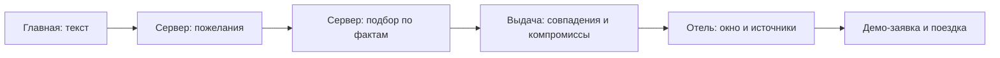

# Защита фронтенда О!кно: объяснение с нуля

Внутренняя шпаргалка для команды, 30.10.2026. Не переносить в публичную сдачу.
Основа — текущий код main f25af17, а не старые прототипы из archive.
Полная карта для помощи в чате: [11-live-code-context.md](11-live-code-context.md).
Общий пятиминутный питч и вопросы по гео/бэкенду: [10-defense.md](10-defense.md).

## 1. С чего начать и что выучить обязательно

Не нужно за два часа учить весь React. Нужно своими словами объяснить один полный путь пользователя,
назначение основных частей кода и ограничения прототипа. Если нет времени, прочитай §2–5, §8 и §10.
Затем открой пять файлов из §6 и пройди вопросы из §9 вслух.

План на 90 минут, оставшееся время — запас на командную репетицию и подготовку демо:

| Время | Действие | Результат |
|---|---|---|
| 0–15 минут | §2–3: продукт, словарь и схема | Можешь без подсказки объяснить, что делает фронт |
| 15–30 | §4–5: поиск и состояние | Можешь провести запрос от ввода до карточки |
| 30–50 | §6: открыть пять файлов | Узнаёшь реальные функции и объясняешь вход/выход |
| 50–65 | §8–9: вопросы | Даёшь короткий ответ и выдерживаешь одно уточнение |
| 65–80 | §10: руками пройти демо | Показываешь выдачу, окно, источник и заявку |
| 80–90 | Рассказать §2 без чтения, затем 5 случайных вопросов | Находишь пробелы до жюри |

Не заучивай минорные версии, все названия агентов и все CSS-классы.
Обязательный минимум: React, TypeScript, FSD, Router, Query, Zustand, API, серверный скоринг,
источники факта, неизвестность, реальные данные и демо, ограничения панорамы.

## 2. Твой рассказ о фронте на 45–60 секунд

«Фронтенд у нас на React и TypeScript. Пользователь описывает поездку своими словами,
а сервер превращает запрос в пожелания и возвращает подходящие отели с рекомендацией стороны и этажей.
Я могу показать этот путь в коде: от формы на главной через запросы API до карточки результата.

Для переходов между страницами используется TanStack Router, для серверных данных и кэша — TanStack Query,
для общих выборов интерфейса — Zustand. Код разделён по Feature-Sliced Design:
страницы собирают блоки, отдельные функции отвечают за поиск, сравнение и избранное.

Самая важная часть интерфейса — объяснить результат: показать источник, уверенность,
ограничения и то, чего мы пока не знаем. На странице отеля можно менять фасад, этаж и дату;
рисунок окна — условная иллюстрация расчёта, а не фотография. Бронь в прототипе демонстрационная,
сохранение заявки работает, оплаты и проверки реальных мест нет».

Это описание зоны, которую ты понимаешь и защищаешь. Не говори «я лично написал каждую строку»,
если это не соответствует работе команды.

Версия на 15 секунд:

«Я объясняю пользовательский путь: желание → серверный подбор → карточка с доказательствами → заявка.
React рисует интерфейс, Query управляет данными сервера, Zustand хранит выбор пользователя.
Расчёты и ранжирование выполняет бэкенд».

## 3. Словарь без лишнего жаргона

| Слово | Простое объяснение | В нашем проекте |
|---|---|---|
| Фронтенд | То, с чем человек взаимодействует в браузере | Поле поиска, карточки, окно, сравнение |
| Бэкенд | Сервер, который выполняет сценарии и хранит данные | Разбор запроса, расчёты, знания, ранжирование |
| React | Библиотека для сборки интерфейса из частей | Компоненты страниц, карточек и кнопок |
| Компонент | Функция, описывающая кусок интерфейса | HotelResultCard, WindowSection |
| JSX / TSX | Разметка интерфейса внутри кода | return с кнопками и полями в .tsx |
| Props | Входные данные компонента | WindowSection получает hotel и detail |
| State | Изменяемое состояние интерфейса | Выбранный этаж, открытый диалог |
| Render | React заново получает описание UI | После смены этажа изменяются подписи и запрос |
| Hook | Функция React для состояния и поведения | useState, useEffect; собственный useSearchFilters |
| TypeScript | JavaScript с проверкой типов до запуска | Проверяет структуру Hotel, Facade и ответа API |
| API | Договор, как фронт запрашивает данные сервера | GET /hotels, POST /searches |
| HTTP | Протокол запрос/ответ | Браузер отправляет запрос, сервер отвечает |
| GET / POST | Получить / отправить данные для обработки | GET карточки, POST создания заявки |
| JSON | Формат передачи структурированных данных | Массив matches и параметры trip |
| Promise / async / await | Работа с результатом, который придёт позже | Ожидание сетевого ответа без остановки всего браузера |
| Router | Выбирает страницу по адресу | /results, /hotel/$id, /trips/$id |
| Query | Хранит ответы сервера и управляет их загрузкой | Каталог, поиск, окно, поездки |
| Cache | Уже полученные данные для повторного использования | Не запрашивать свежий каталог при каждом переходе |
| Query key | Адрес записи в кэше | [hotel-geo, hotelId, endpoint с фасадом/этажом/датой] |
| Zustand / store | Общая память выбора между компонентами | ID отелей сравнения и избранного |
| Mutation | Запрос, который меняет серверное состояние | Создание заявки через useMutation |
| Invalidation | Пометить кэш устаревшим | После заявки обновить список поездок |
| SSR | Сервер формирует первый HTML | TanStack Start, loader страницы отеля |
| Hydration | React подключает обработчики к серверному HTML | После загрузки кнопки становятся интерактивными |
| Lazy loading | Загрузить код/данные, когда они понадобятся | Карта и геосекции возле области просмотра |
| Polling | Периодически перечитывать сервер | Ход агента раз в 1,2 с |
| SSE | Сервер сам присылает события в открытое соединение | Доступно в API; основной useAgentRun использует polling |
| FSD | Правила разделения кода по ответственности | app → pages → widgets → features → entities → shared |

Пример разницы props/state: отель передан в WindowSection как props; выбранный этаж живёт внутри как state.
Когда этаж меняется, сам объект отеля не нужно изменять.

## 4. Главный путь: «хочу тихий номер у моря»



### Шаг 1. Пользователь вводит текст

pages/home/ui/home-page.tsx хранит ввод и быстрые пожелания. buildLandingQuery собирает итоговую строку.
На отправке Router переводит в /search?q=… — текст виден в URL.
Быстрые кнопки добавляют слова. Основной смысловой разбор не спрятан в CSS или React: его делает API.

### Шаг 2. Получаем понятные машине пожелания и каталог

useSearchFilters отправляет POST /api/v1/intents с текстом и получает intent:
например, пожелания тишины и вида, их важность, параметры и даты/гостей в trip.
Отдельно GET /api/v1/hotels получает каталог. Эти два запроса могут идти параллельно.
«Чип» — отдельное пожелание, которое можно удалить или уточнить, например «С собакой до 30 кг».

### Шаг 3. Сервер подбирает варианты

Когда intent готов, фронт делает POST /api/v1/searches с text, chips, trip, useProfile.
В ответе — searchId и matches: отель, оценка, выполнение пожеланий, компромисс и рекомендованный вариант.
Сервер сам смотрит знания, выбирает фасад/этажи и ранжирует. React не измеряет тишину и не определяет вид по фото.

### Шаг 4. Показываем выдачу

/search ждёт готовности данных либо ошибки и переводит на /results.
Оба экрана используют один QueryClient и тот же хук, поэтому получают результат из кэша.
hotelFromApi соединяет информацию каталога и поисковый match в удобную для компонентов модель Hotel.
ResultsPage рисует HotelResultCard; сначала 20 карточек, затем можно показать ещё.
Это порционное отображение уже пришедших matches. Серверная выдача обычно ограничена 30 результатами.

### Шаг 5. Открываем отель с контекстом

Адрес /hotel/$id?sid=… содержит ID отеля и сохранённого поиска.
Загрузчик получает карточку и поиск: поэтому помнит даты, гостей и рекомендуемую категорию.
В блоке окна смена фасада/этажа/даты меняет параметры API и ключ кэша.
По кнопке источников интерфейс загружает конкретный факт и показывает доказательства.

### Шаг 6. Создаём заявку

Вошедший гость выбирает категорию и тариф, даты, гостей, пожелание.
POST /bookings сохраняет демо-заявку, список поездок помечается для обновления.
В поездке ответ демо-отельера опрашивается каждые 2 секунды до смены requested.
Реальную оплату и подтверждённое наличие мест мы не обещаем.

Как сказать всё одной фразой:

«Форма передаёт желание в API; сервер возвращает намерение и ранжированные результаты;
Query сохраняет их в кэше; адаптер переводит контракт в модель карточки, а React её показывает».

## 5. Самое важное архитектурное различие

### Почему Query, Zustand и useState нужны одновременно

useState — локальное: какой этаж выбран сейчас, открыт ли диалог.
Zustand — общий выбор: какие ID добавлены в сравнение, какие отели избраны, кто вошёл.
Query — данные сервера: что за отель, что вернул поиск, готов ли расчёт окна.

Пример: кнопка «В сравнение» меняет ID в Zustand. Когда открываем сравнение, Query вызывает API
с этими ID. Сервер возвращает оценки, а страница их рисует. Не нужно складывать все ответы сервера
в один большой Zustand-store и вручную писать механизм свежести, ошибок и повторной загрузки.

### Как устроен FSD на нашем примере

app/routes выбирает ResultsPage → страница собирает HotelResultCard из widgets → кнопка сравнения
использует features/compare-hotels → тип Hotel лежит в entities/hotel → HTTP-клиент в shared/api.

Зависимости идут вниз, соседние слайсы не импортируют внутренности друг друга.
Публичный index.ts — входная дверь модуля: остальной код использует его, а не случайный внутренний файл.
Для небольшого проекта слоёв может быть много, но здесь несколько ролей и поверхностей;
это помогает отделить интерфейс от общих сценариев. Правила проверяет скрипт, а не только договорённость.

### Что означает «данные свежие пять минут»

Если Query уже получил каталог, он может использовать его сразу. По умолчанию пять минут он считает
эти данные свежими. Это не таймер запросов раз в пять минут. После устаревания обновление зависит
от события и настроек; у нашего поиска обновление по возвращению фокуса отключено.
Неактивные записи в браузере остаются до 30 минут. После полной перезагрузки память Query не постоянна.

## 6. Пять файлов, которые нужно узнать глазами

Пути — ссылки на реальные исходники. Открой каждый и найди названную функцию.
Разбирай по схеме: что пришло → что меняется/запрашивается → что вернулось.

### Файл 1. useSearchFilters — сердце фронтового сценария

[use-search-filters.ts](../../frontend/src/features/hotel-search/model/use-search-filters.ts).
Найди три запроса: intent, catalog, search, а затем ranked.

Сокращённый фрагмент, смысл совпадает с кодом:

```tsx
const intent = useQuery({
  queryKey: ["intent", text],
  queryFn: ({ signal }) => api<ApiIntent>("/intents", {
    method: "POST", body: { text }, signal,
  }),
  enabled: !draft,
});
```

useQuery организует загрузку и кэш. queryKey различает запросы с разным текстом.
queryFn описывает, что запросить. signal позволяет отменить сетевую работу.
enabled запрещает автоматический запрос, когда уже есть отредактированное намерение draft.
ApiIntent — TypeScript-тип ответа, не проверка фактического JSON во время работы.

В блоке search условие enabled ждёт готового searchIntent; placeholderData: keepPreviousData
сохраняет прежнюю выдачу при обновлении. ranked соединяет match с каталогом, не вычисляет географию.

Контрольная фраза: «Хук связывает состояние фильтров с серверными запросами и готовит данные для страницы».

### Файл 2. HTTP-клиент api — одна точка общения с API

[client.ts](../../frontend/src/shared/api/client.ts).
Найди ветку demo, fetch и проверку response.ok.

Функция добавляет /api/v1, заголовки, при необходимости Bearer-токен и JSON-тело.
В браузере использует тот же origin; SSR знает BACKEND_URL. Запрос получает таймаут до 60 секунд.
На ошибке создаёт ApiError с кодом и понятным сообщением.
api<T> описывает ожидаемый тип, но body as T не проверяет структуру ответа в runtime.

Контрольная фраза: «Сетевые правила и ошибки общие, поэтому страницы не дублируют fetch с разными настройками».

### Файл 3. Zustand-store сравнения

[store.ts](../../frontend/src/features/compare-hotels/model/store.ts).
Найди ids, toggle и persist.

```tsx
toggle: (id) =>
  set((s) => ({
    ids: s.ids.includes(id)
      ? s.ids.filter((x) => x !== id)
      : [...s.ids, id].slice(-3),
  })),
```

Если ID уже выбран — убрать. Если нет — создать новый массив с ID и оставить последние три.
filter/spread возвращают новый массив: исходное состояние не меняется напрямую.
persist сохраняет ID и критерии в sessionStorage, чтобы пережить обновление вкладки.
Сам store не запрашивает оценки отелей; это делает useComparison через /compare.

Контрольная фраза: «Store хранит выбор, а сервер считает сравнение».

### Файл 4. WindowSection — пример state → API → UI

[window-section.tsx](../../frontend/src/pages/hotel/ui/window-section.tsx).
Найди useState для фасада/этажа/даты, useGeoQuery и WindowPanorama.

```tsx
const [floor, setFloor] = useState(initialFloor);
```

Это пара «текущее значение» и «функция обновления». Обработчик кнопки вызывает setFloor;
React перерисовывает компонент. Новое значение попадает в endpoint window и ключ запроса.
Само по себе setFloor не является вызовом сервера: новый запрос организует useGeoQuery.
Запрос активируется у видимой секции, а WindowPanorama отображает условную SVG-иллюстрацию.
В реальном файле initialFloor вычисляется из количества этажей и рекомендации.

Контрольная фраза: «Я меняю параметры окна, получаю расчёт с сервера и отображаю его с оговорками».

### Файл 5. sessionApi — как защищённые запросы получают сессию

[session.ts](../../frontend/src/entities/session/api/session.ts).
Найди restoreSession, refreshing и sessionApi.

Access-токен лежит в памяти. Если он истёк/скоро истечёт, sessionApi пытается восстановиться
через refresh-cookie и CSRF-заголовок. Если нет сессии — открывает вход.
При 401 пробует обновиться один раз. Один общий Promise не даёт одновременно запустить множество refresh.
Сервер проверяет подпись токена, роль и принадлежность данных. Скрытая кнопка в UI не даёт защиты сама по себе.

Контрольная фраза: «Фронт управляет сессией, а решение о доступе принимает сервер».

## 7. Если жюри открывает незнакомый кусок React

Сначала найди название компонента/функции, её аргументы, hooks и return.
В .tsx верх обычно подключает зависимости, середина готовит состояние/данные,
return описывает экран. В model чаще преобразования и правила представления.

| Конструкция | Что ответить |
|---|---|
| useState | Локальное состояние компонента; setter сообщает React о новом значении |
| useEffect | Действие после рендера: подписка, таймер, observer; return снимает подписку/очищает ресурс |
| useMemo | Переиспользование вычисленного значения, пока зависимости не поменялись; это не сетевой кэш |
| useRef | Ссылка на DOM-элемент или значение между рендерами; изменение ref само не вызывает рендер |
| useQuery | Загрузка и кэш данных сервера, статусы и обновления |
| useMutation | Отправка действия, меняющего данные; успех/ошибка/ожидание |
| .map | Преобразовать массив; в JSX часто создать список карточек |
| .filter | Оставить элементы по условию |
| key={hotel.id} | Стабильный ID, чтобы React различал элементы списка |
| ?. и ?? | Безопасно обратиться к необязательному полю; взять запасное значение при null/undefined |
| …spread | Собрать новый объект/массив с прежними и обновлёнными полями |
| await api(...) | Дождаться результата запроса; потом обработать его |
| import type | Тип нужен при проверке кода и не становится поведением в браузере |

Сравни useMemo и useEffect: первый вычисляет значение, второй подключает внешнее действие.
Например, преобразование matches в карточки — useMemo; установка IntersectionObserver — useEffect.
Cleanup важен, чтобы ушедшая страница не продолжала держать таймеры/слушатели и обновлять неактуальный UI.

Если не знаешь точную реализацию, скажи:
«Это вне части, которую я сейчас разобрал подробно. Общий принцип такой: … Точную функцию покажу в коде».
Затем попроси напарника раскрыть расчёт или открой файл из карты. Конкретная граница знаний лучше выдуманного ответа.

## 8. Вероятные вопросы жюри и короткие ответы

### 1. Почему React и этот набор инструментов?

«React собирает интерфейс из компонентов, TypeScript проверяет договорённости между ними.
Router отвечает за страницы, Query за серверные данные, Zustand за общий выбор пользователя.
Это позволяет каждой части решать отдельную задачу».
Уточнение: Start даёт серверный HTML и маршрутизацию, Vite собирает приложение, Nitro запускает сервер и прокси.
Не заявляй, что ты сравнил все фреймворки бенчмарком.

### 2. Почему не хранить всё в Zustand?

«Выбор отелей и UI удобно хранить в store, но у серверных данных есть свежесть,
повторные запросы, ошибки и отмена. Этим уже управляет Query».
Опора: query-client.ts, use-search-filters.ts, compare-hotels/model/store.ts.

### 3. Поиск делает фронтенд или LLM?

«Фронт передаёт запрос. LLM или правила выделяют пожелания на сервере,
а детерминированный код ранжирует отели по сохранённым фактам».
Уточнение: наличие matching.ts не означает, что основная живая выдача считается в браузере.

### 4. Откуда взялось 87% совпадения?

«Сервер считает выполнение пожеланий с весами важности и штрафом за обязательные условия.
Фронт переводит score из 0–1 в проценты. Это оценка соответствия модели, не вероятность счастливого отпуска».
Уточнение: неизвестное в серверном скоринге имеет приор 0,5, но в UI остаётся unknown.

### 5. Как не перепутать неизвестность с отрицательным ответом?

«В контракте есть unknown и отдельные отсутствующие значения. В UI сохраняем этот признак
и показываем отсутствие данных, а не утверждение “нет моря” или “тихо”».
Опора: hotelFromApi, unknownCriteria, GeoStatus. Число 0 в некоторых UI-моделях без unknownCriteria читать нельзя.

### 6. Почему не показывать загрузку при каждом запросе?

«Первая загрузка блокирует экран, когда данных ещё нет. При уточнении оставляем прежнюю выдачу
и показываем обновление. Так пользователь не теряет контекст».
Уточнение: оверлей имеет порог 120 мс; фальшивых процентов и обязательной длительности нет.

### 7. Что сделано для скорости?

«Кэш и повторное использование запросов, старые данные при обновлении, загрузка геосекций у viewport,
динамический импорт карт и отдельных тяжёлых сцен. Геофакты подготовлены заранее».
Уточнение: Lighthouse не измеряли в этой сессии; сборка предупреждает о крупных chunks.
Следующее улучшение — измерить загрузку и задержки на реальном устройстве и разделить тяжёлые части по результатам.

### 8. Почему карта не запускается на сервере?

«MapLibre и WebGL требуют браузерные API. ClientOnly включает соответствующий блок после монтирования,
а lazy откладывает загрузку кода». SSR не умеет предоставить настоящий window/document браузера.

### 9. Как показываете работу агентов?

«Получаем runId и читаем его шаги через API каждые 1,2 секунды до завершения.
Трасса содержит реальные инструменты и результаты; интерфейс их отображает».
Уточнение: сервер умеет SSE, но основной хук сейчас polling. Это проще, но создаёт повторные запросы;
SSE мог бы уменьшить их число при большом числе наблюдателей.

### 10. Панорама — нейросеть нарисовала реальный вид?

«Это условная SVG-иллюстрация объектов по расчёту видимости.
Геометрию считает сервер по открытым данным, фронт показывает понятную схему с оговоркой».
Море в процентах — доля направлений расчёта, а не точная площадь моря на снимке.

### 11. Голос и фото работают сами по себе?

«Голос использует поддержку распознавания в браузере. Фото сервер отправляет vision-модели
и возвращает текст пожелания, который человек может исправить. Без LLM для фото предлагаем ввод словами».
Уточнение: .txt тоже поддержан; фото не доказывает, что в конкретном отеле такой вид.

### 12. Все данные настоящие?

«Отели и геоданные настоящие, вычисленные свойства — модельные оценки.
Цены, категории, рейтинги и ответы симулятора демонстрационные и помечены».
Фото: Wikimedia с лицензиями плюс общие AI-иллюстрации с подписями, не реконструкции реальных номеров.

### 13. Локальное Демо и тестовая Анна — одно и то же?

«Разные вещи. В локальном Демо API подменён в приложении. Вход тестовой персоной работает
с настоящим сервером и общим учебным аккаунтом».
В текущей шапке обычный вход/регистрация; не обещай старый переключатель ролей из README.

### 14. Можно украсть токен из localStorage?

«Мы access-токен в localStorage не кладём, он в памяти. Refresh — в HttpOnly cookie,
для восстановления отправляется CSRF-заголовок. Роли и доступ к отелю проверяет сервер».
Не говори «значит XSS невозможен»: память тоже доступна исполняемому JS, а защиты решают разные задачи.

### 15. Что будет при отсутствии сети или ошибке API?

«Общий HTTP-клиент формирует понятную ошибку, RequestState показывает её и кнопку повтора.
У запросов есть отмена и таймаут; существующие данные можно сохранить на экране при обновлении».
Это не полный offline-режим и не обещание, что любой сценарий без сети продолжится.

### 16. Как TypeScript проверяет сервер?

«Типы получаем из OpenAPI. Это помогает ловить несовпадения при разработке.
В браузере типы стираются: полноценной проверки схемы каждого JSON-ответа сейчас нет».
На сервере запросы и ответы описаны Pydantic-моделями. Runtime-валидация клиента — возможное улучшение.

### 17. Что тестировали?

«Полный frontend check проверяет линтер, границы FSD, типы, unit/контрактные тесты и сборку.
Есть проверки API-адаптеров, хранения сравнения, входа, даты бронирования, геопредставлений и фото/голоса».
В этой сессии check прошёл. Браузерные проверки из прошлых сессий описаны в журнале;
не выдавать их за новый ручной прогон перед защитой.

### 18. Как проверяли доступность интерфейса?

«Есть семантические кнопки и формы, подписи для скринридера, обработка Escape,
возврат фокуса у панели источников и поддержка reduced motion у анимаций».
Полную сертификацию WCAG не заявляли. Пример — fact-sources-modal.tsx.

### 19. Почему лимит сравнения три? Есть пагинация?

«В интерфейсе выбраны максимум три отеля, чтобы сравнение оставалось читаемым.
Результаты отображаются порциями по 20, но это не серверная пагинация; для больших каталогов её нужно добавить».
При четвёртом ID store оставляет последние три. Нет виртуализации всей длинной выдачи.

### 20. Что бы улучшили после хакатона?

«Для продукта — проверить реальные окна и привязать категории поставщика к фасадам/этажам.
Для фронта — измерить скорость на слабом устройстве, уменьшить тяжёлые части сборки,
добавить настоящую серверную пагинацию и больше сквозных проверок ключевого пути».
Если спрашивают одно главное: проверка достоверности обещания, потому что на ней основана ценность продукта.

## 9. Самопроверка: отвечай вслух, не подглядывая

Каждый ответ 15–25 секунд. Оценка: 0 — не объяснил, 1 — назвал слова, 2 — объяснил и показал пример.
Цель — 2 по первым шести вопросам; точность важнее числа терминов.

1. Что именно получает человек от О!кна? Почему ему мало «вид на море» в карточке?
2. Проведи запрос от главной до выдачи: какие три запроса делает useSearchFilters?
3. Кто ранжирует отели? Зачем тогда hotelFromApi на фронте?
4. Чем отличаются Query, Zustand и useState? Приведи по одному примеру из нашего кода.
5. Пользователь сменил этаж. Где хранится значение и как меняется запрос?
6. Что в продукте реально, что рассчитано, что синтетическое?
7. Почему выбранные отели переживают reload? Почему токен не должен храниться там же?
8. Чем процент совпадения отличается от confidence и звёзд отеля?
9. Как фронт получает шаги агента? Когда перестаёт опрашивать?
10. Почему нужен ClientOnly? Чем SSR отличается от браузерного рендера?
11. Фото загрузили без ключа LLM. Что увидит пользователь?
12. API вернул ошибку. Что покажет UI и как повторить запрос?
13. Проверяет ли api<Hotel> реальную структуру JSON во время работы?
14. Что значит «свежесть пять минут»? Запрос обязательно выполняется раз в пять минут?
15. Почему независимая точность вида пока неизвестна, даже если все unit-тесты зелёные?

Ответы: §4, §5, §6 и §8. Если застрял, прочитай соответствующий ответ, закрой текст и повтори своими словами.
Для тренировки в этом чате: «Погоняй меня по фронту: один вопрос, жди ответ, затем коротко поправь».
Не учи весь список подряд: сначала шесть обязательных, потом случайные уточнения.

## 10. Репетиция демо на 60–90 секунд

1. Ввести «тихий номер с видом на море и закатом, 12–15 ноября, вдвоём».
   Сказать: «Сервер выделил пожелания; у каждого результата виден компромисс».
2. Открыть один заранее проверенный отель. Сказать: «Рекомендация относится к стороне и этажам».
3. В «Вашем окне» поменять один этаж при той же стороне и дате.
   Сказать: «Меняются параметры расчёта, а схема помогает понять ответ; это не фото».
4. Открыть источники одного факта. Показать метод, дату, уверенность и ограничения.
5. Если позволяет время — открыть форму заявки с пожеланием. Не ждать медленного ответа отельера на сцене.

Для контрастного окна в старой проверке использован «Салют»:
/hotel/716427ad-1e37-5cf9-a8e5-31d6746396f1, W, этаж 1 → 5, 2026-11-12.
Перед выступлением повторить именно эти клики. Не сравнивать разные этажи вместе с разными датами,
иначе зрителю непонятно, что стало причиной изменения.
Подготовить уже открытую карточку и запись; при зависании через несколько секунд перейти к резерву.
Не пытаться демонстрировать новый непроверенный отель впервые при жюри.

Используй короткий запрос: у формы лимит 4000 символов, а у серверного контракта сейчас 2000.
Этот разрыв ещё нужно исправить; длинное вложение может получить 422. Для короткого демо он не мешает.

## 11. Формулировки, которые легко защитить

| Вместо слишком сильного заявления | Скажи точно |
|---|---|
| «LLM знает вид из окна» | «LLM понимает желание; вид рассчитывается по геоданным» |
| «Это настоящий вид из номера» | «Это условная иллюстрация расчёта» |
| «95% точности» | «Уверенность модели в утверждении; натурная точность ещё не измерена» |
| «Это шум в децибелах в комнате» | «Это условный наружный индекс по источникам» |
| «Бронь подтверждена реальным отелем» | «Заявка сохранена, ответ демо-отельера симулируется» |
| «Всё работает без LLM» | «Основные сценарии работают на правилах; перевод фото в желание требует модели» |
| «SSE/WebSocket ведёт трассу в UI» | «Текущий хук опрашивает запуск раз в 1,2 с; SSE есть в API» |
| «20 карточек — серверная пагинация» | «Это порции отображения; серверный набор ограничен отдельно» |
| «TypeScript проверил пришедший JSON» | «Типы проверили наш код при сборке, отдельного парсинга схемы ответа нет» |
| «Избранное привязано к аккаунту» | «Избранное хранится локально в этом браузере» |
| «Все фотографии реальные» | «Есть фото с лицензиями и подписанные AI-иллюстрации» |
| «Я знаю весь код наизусть» | «Могу объяснить основной путь, решения и границы, а детали открыть в функции» |

На вопрос про ИИ:
«Да, использовали ИИ как инструмент разработки. Мы отвечаем за выбранную архитектуру,
проверки и ограничения. Давайте покажу путь запроса и конкретную функцию».
Затем действительно открой useSearchFilters или WindowSection и объясни входы/выходы.
